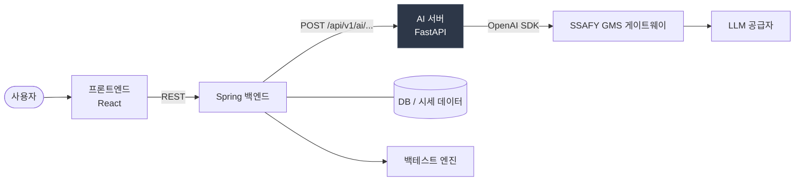
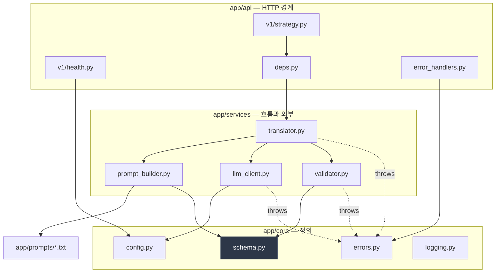
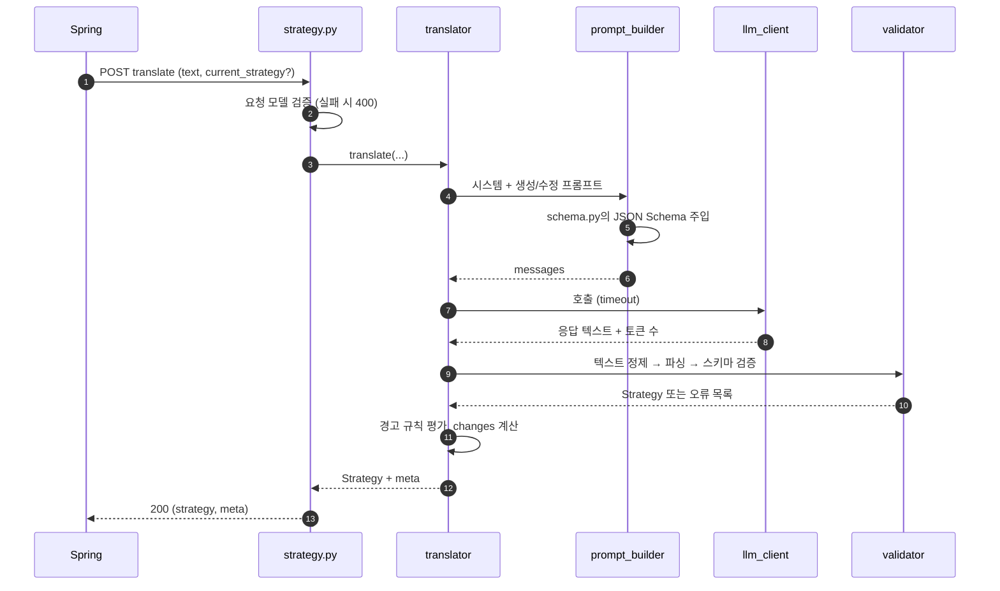
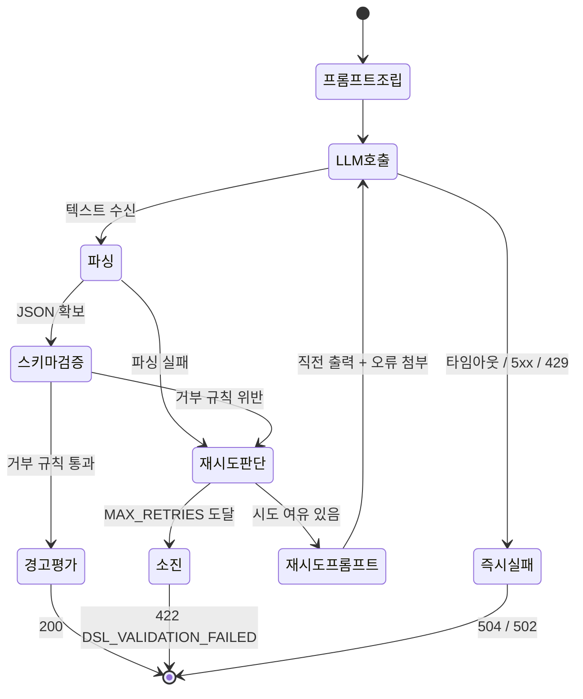
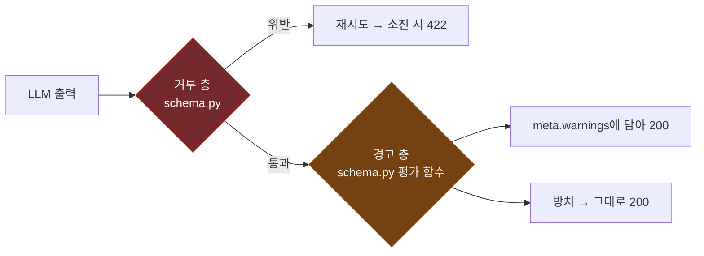
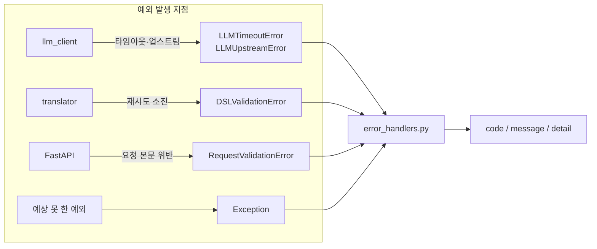
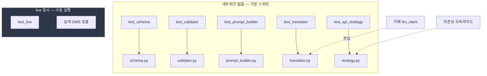

# 아키텍처

AI 서버가 어떤 조각으로 나뉘고, 요청 하나가 그 조각들을 어떤 순서로 지나는지 그린 문서다.

무엇을 만들지는 [PLAN.md](PLAN.md), 왜 그렇게 정했는지는 [DECISIONS.md](DECISIONS.md), 어떤 순서로 할지는 [TASKS.md](TASKS.md)에 있다. 여기는 **구조와 흐름만** 다룬다.

**DSL 필드명과 허용값은 이 문서에 적지 않는다.** 정의처는 `app/core/schema.py` 하나다. 여기서는 모델 이름과 모듈 경계까지만 말한다.

---

## 1. 시스템 컨텍스트

호출 방향이 한쪽뿐이다. AI 서버는 Spring을 부르지 않고, DB에도 붙지 않는다.

| 경계 | 규약 | 근거 |
|---|---|---|
| 프론트 → AI 서버 | **없다.** 프론트는 Spring만 부른다 | CORS 설정을 두지 않는 이유 ([DECISIONS 원칙 3](DECISIONS.md)) |
| Spring → AI 서버 | 동기 HTTP. 요청 본문에 필요한 데이터를 담아 보낸다 | AI 서버는 무상태 ([DECISIONS 원칙 1](DECISIONS.md)) |
| AI 서버 → GMS | 공급자 교체는 `LLM_BASE_URL` 변경 | 코드에 공급자 이름 분기를 두지 않는다 |
| 인증 | 미정. `main.py` 미들웨어에 자리만 표시해 뒀다 | 백엔드 계약 확정 후 |

응답 시간은 LLM 왕복에 좌우되고 재시도가 붙으면 최대 세 배가 된다. **Spring 쪽 타임아웃이 그보다 길어야 한다.** 통합(L-4) 때 맞출 값이다.

---

## 2. 내부 계층

**의존은 안쪽으로만 흐른다.** `core`는 `services`와 `api`를 모른다. 그래서 스키마 테스트가 네트워크 없이 돈다.

| 계층 | 책임 | 하지 않는 것 |
|---|---|---|
| `api` | 요청·응답 변환, 의존성 주입, 예외의 HTTP 변환 | 비즈니스 로직, `try/except`로 상태 코드 만들기 |
| `services` | 오케스트레이션, 프롬프트 조립, 검증, 외부 통신 | 검증 규칙 정의 (`schema.py` 소관) |
| `core` | DSL 정의, 설정, 예외 타입, 로깅 | 외부 호출 |
| `prompts` | 프롬프트 문구 | — (코드가 아니다. 수정에 배포가 딸리지 않는 이유) |

계획서는 예외 핸들러를 `main.py`에 두라고 적었지만, 실제 구현은 `app/api/error_handlers.py`로 빼고 `main.py`가 등록만 한다. `main.py`를 앱 조립과 미들웨어만 남기려고 나눴다.

### 이 구조를 지탱하는 두 규칙

**DSL 필드명은 `schema.py` 밖으로 새지 않는다.** 프롬프트에 들어갈 스펙 문구조차 `schema.py`가 만든 JSON Schema를 주입해 만든다. 백엔드 명세가 도착하면 교체 대상이 `schema.py`와 프롬프트 `.txt` 두 종류로 끝나야 한다 (Phase 2, K-1).

**환경변수를 읽는 파일은 `config.py` 하나다.** 다른 파일은 `os.environ`을 직접 만지지 않고 설정 객체를 주입받는다.

---

## 3. 요청 흐름 — 전략 변환

`POST /api/v1/ai/strategies/translate` 하나가 신규 생성과 수정 두 경로를 겸한다. 요청에 현재 전략이 실려 오면 수정, 없으면 생성이다.

라우터는 얇게 둔다. LLM도 검증기도 직접 부르지 않는다.

**재시도할 때 대화를 누적하지 않는다.** 매번 시스템 프롬프트 + 원래 입력 + 직전 출력 + 오류만으로 새 요청을 만든다. 대화가 길어지면 모델이 자기 실수를 반복하고 토큰도 더 든다.

---

## 4. 재시도 루프

| 실패 종류 | 재시도 | 이유 |
|---|---|---|
| JSON 파싱 실패 | 한다 | 오류 문구를 붙이면 다음 시도가 고친다 |
| 거부 층 검증 실패 | 한다 | 필드 경로별 오류를 붙인다 |
| LLM 타임아웃 | **하지 않는다** | 대기 시간이 배로 늘어난다. 즉시 504 |
| LLM 429·5xx | **하지 않는다** | 즉시 502. 백오프는 필요해지면 그때 |

기본 `MAX_RETRIES`가 2라 LLM 호출은 요청당 최대 세 번이다.

**검증 오류 문구는 두 벌 만든다.** 재시도 프롬프트에 붙이는 기술 문구와, 응답 `detail`에 담는 한국어 문구다. 한 문자열을 양쪽에 쓰면 어느 한쪽은 반드시 부적절해진다. 재시도 성공률은 앞쪽 문구 품질이 좌우한다.

---

## 5. 검증 3층

검증이 한 덩어리가 아니다. 세 층이 서로 다른 곳에서 일어난다.

| 층 | 무엇을 잡나 | 처리 |
|---|---|---|
| 거부 | 표현이 불가능하거나 LLM이 명백히 틀린 것 | 검증 실패로 재시도 |
| 경고 | 유효하지만 전략적으로 위험한 것 | 200으로 통과, `meta.warnings`에 기록 |
| 방치 | 나머지 | 아무것도 안 한다 |

경계를 어디에 두는지와 각 층에 무엇이 들어가는지는 [DECISIONS.md의 "검증을 세 층으로 나눈다"](DECISIONS.md)에 있다. 요지는 **결과가 조용히 틀리는 것만 막고, 나쁘게 나오지만 사용자가 배울 수 있는 것은 막지 않는다.**

`meta.warnings`는 역할 2로 가는 다리이기도 하다. 지금은 규칙이 채우고, 견고성 모델이 완성되면 같은 자리를 점수가 채운다. API 형태를 바꾸지 않고 내용만 갈아끼운다.

---

## 6. 오류 처리

**HTTP 변환은 `error_handlers.py` 한 곳에서만 한다.** 예외는 발생 지점에서 도메인 예외로 번역하고, 라우터는 상태 코드를 만들지 않는다.

`DomainError`가 `status_code`와 `code`를 속성으로 들고 있어서 핸들러가 예외 종류를 분기하지 않는다. 예외 타입을 늘려도 핸들러는 그대로다.

응답 형태와 상태 코드 표는 [README.md의 "오류 응답"](../README.md)에 있다. Spring과의 계약이므로 그쪽이 정본이다.

나가면 안 되는 것: 스택 트레이스, LLM 원문, API 키, 프롬프트 전문. 전부 로그에만 남는다.

---

## 7. 횡단 관심사

**요청 ID.** 미들웨어가 `X-Request-ID` 헤더를 이어받고 없으면 만든다. `contextvar`에 실어 두면 로깅이 어느 계층에서든 같은 ID를 붙인다. 응답 헤더로 되돌려준다.

**로깅.** 요청 완료마다 메서드·경로·상태·소요 시간을 남긴다. LLM 호출은 시도 횟수·소요 시간·토큰 수·성공 여부를 남긴다. 사용자 입력 원문은 남기고 API 키는 남기지 않는다.

**설정.** 필수 환경변수가 없으면 임포트 단계에서 죽는다. 첫 요청에서 죽으면 안 된다. 설정 객체를 출력해도 키는 마스킹된다.

**헬스체크는 LLM을 부르지 않는다.** 과금 요인이 헬스체크에 붙으면 안 된다. `/health/ready`는 프롬프트 파일 존재만 본다.

---

## 8. 테스트 경계

**실제 LLM을 치는 테스트는 기본 스위트에 없다.** CI가 과금되고 느려지고 불안정해지는 걸 막는다. `llm_client`를 인터페이스 뒤에 숨긴 이유가 이것이다.

골든 케이스는 완전 일치로 판정하지 않는다. "검증을 통과하는가 + 핵심 필드 몇 개가 기대와 맞는가"로 본다. 완전 일치를 요구하면 프롬프트를 손댈 때마다 전부 깨진다.

---

## 9. 확장 지점

지금 파일을 만들지 않는다. 붙일 자리만 표시해 둔다.

| 확장 | 붙는 자리 | 영향 범위 |
|---|---|---|
| 역할 2 (견고성 점수) | `api/v1/score.py`, `services/scorer.py` | 라우터 추가. `meta.warnings` 자리를 점수가 대체 |
| LLM 공급자 교체 | `LLM_BASE_URL` 환경변수 | 코드 수정 없음 |
| DSL 스펙 교체 | `core/schema.py` + 프롬프트 `.txt` | 그 밖의 파일이 수정되면 원칙 위반 |
| 인증 | `main.py` 미들웨어 (TODO 표시 있음) | 백엔드 계약 후 |
| 지연 개선 | translator 동기 호출 → 스트리밍·큐 | 1차는 동기로 간다 |

숫자 범위를 넓히는 건 코드 한 줄이고 프롬프트는 자동으로 따라온다. 열거형 값을 늘리면 프롬프트 재튜닝이 붙는다. 구조를 바꾸면 프롬프트를 처음부터 다시 쓴다.

---

## 10. 구현 현황

| 조각 | Epic | 상태 |
|---|---|---|
| 패키지 골격, 설정, 헬스 | A | 있음 |
| 예외 계층, 핸들러, 요청 ID 로깅 | C | 있음 |
| `schema.py` | B′ | 없음 |
| `validator.py` | D | 없음 |
| 프롬프트, `prompt_builder.py` | E | 없음 (`/health/ready` 503의 원인) |
| `llm_client.py` | F | 없음 |
| `translator.py` | G | 없음 |
| `strategy.py`, `deps.py` | H | 없음 |

진행 상태의 정본은 Jira다. 이 표는 다이어그램의 어느 부분이 아직 그림인지 표시하는 용도다.
