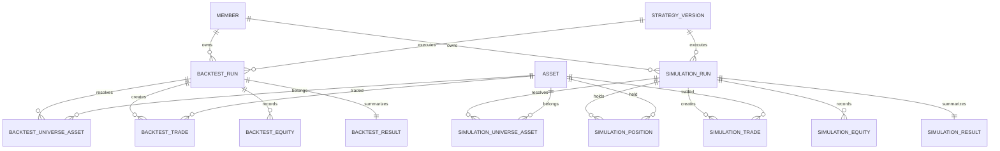

# 백테스팅 · 모의투자 ERD

## 1. 범위와 전제

이 문서는 백테스팅과 서비스 내부 모의투자에 필요한 실행 정보, Universe, 가상 체결, 현재 포지션, 자산 변화를 정의한다.

다음 테이블은 공통 도메인에서 관리하며 이 문서에서는 식별자만 참조한다.

- `member`
- `strategy_version`
- `asset`
- `candle`

`asset_id`는 심볼 문자열이 아니라 거래소, 마켓, 기준통화, 거래지원 기간을 포함한 내부 식별자다. 모든 시각은 UTC로 저장한다.

RabbitMQ Queue, Backtest Worker, Container, Nginx는 인프라 구성 요소이므로 ERD에 테이블로 추가하지 않는다.

---

## 2. 설계 기준

- `StrategyVersion`은 실행 시점의 불변 전략 버전이다.
- 백테스트와 모의투자는 동일한 전략 코어와 실행 설정을 사용한다.
- MVP의 Universe는 Upbit KRW 거래대금 상위 30종목이며, 리밸런싱 시점마다 다시 계산한다.
- 따라서 실행 대상 종목은 사용자가 고정 선택한 목록이 아니라 리밸런싱 시점별 Universe 결과로 저장한다.
- MVP는 실제 주문 상태가 아닌 가상 체결만 저장하므로 별도의 `order` 테이블은 만들지 않는다.
- 현재 모의투자 포지션은 `simulation_position`, 포지션 변경 이력은 `simulation_trade`로 관리한다.
- 금액·가격·수량은 부동소수점이 아닌 `DECIMAL`로 저장한다.

---

## 3. 전체 관계

`candle`은 각 Run의 `market_data_version`, `timeframe`, `asset_id`, 시간 범위 조건으로 조회한다. Equity의 평가 시점이나 Trade의 체결 시점과 직접 FK를 맺지 않고, 시장 데이터 버전과 시각으로 재현한다.

---

## 4. 백테스팅 테이블

### 4.1 `backtest_run`

백테스트 한 번의 실행과 실행 당시의 불변 설정을 저장한다.

| 컬럼 | 타입 | 제약 | 설명 |
| --- | --- | --- | --- |
| `backtest_id` | UUID | PK | 백테스트 식별자 |
| `member_id` | UUID | FK, NOT NULL | 실행 회원 |
| `strategy_version_id` | UUID | FK, NOT NULL | 실행한 전략 버전 |
| `status` | VARCHAR(20) | NOT NULL | `QUEUED`, `RUNNING`, `COMPLETED`, `FAILED` |
| `period_start` | TIMESTAMPTZ | NOT NULL | 평가 기간 시작 |
| `period_end` | TIMESTAMPTZ | NOT NULL | 평가 기간 종료 |
| `timeframe` | VARCHAR(10) | NOT NULL | MVP `1H` |
| `quote_currency` | VARCHAR(10) | NOT NULL | MVP `KRW` |
| `initial_capital` | DECIMAL(24,8) | NOT NULL | 초기 현금 자산 |
| `fee_rate` | DECIMAL(12,8) | NOT NULL | 실행 당시 수수료율 |
| `slippage_bps` | DECIMAL(12,4) | NOT NULL | 실행 당시 Slippage |
| `rebalance_interval` | VARCHAR(20) | NOT NULL | 리밸런싱 주기 |
| `execution_price_rule` | VARCHAR(30) | NOT NULL | MVP `NEXT_CANDLE_OPEN` |
| `engine_version` | VARCHAR(50) | NOT NULL | 실행 엔진 버전 |
| `market_data_version` | VARCHAR(50) | NOT NULL | 사용한 시장 데이터 버전 |
| `queued_at` | TIMESTAMPTZ | NOT NULL | Job 등록 시각 |
| `started_at` | TIMESTAMPTZ | NULL | 실행 시작 시각 |
| `completed_at` | TIMESTAMPTZ | NULL | 실행 완료 시각 |
| `failure_reason` | TEXT | NULL | 실패 시 원인 |

`period_start < period_end`, `initial_capital > 0`, `fee_rate >= 0`, `slippage_bps >= 0` 제약을 적용한다. 동일한 `strategy_version_id`, 실행 설정, `engine_version`, `market_data_version`을 사용하면 동일 결과가 나와야 한다.

### 4.2 `backtest_universe_asset`

각 리밸런싱 시점에 계산된 Universe와 최종 선택 결과를 저장한다. 사용자가 직접 선택한 자산 목록을 의미하지 않는다.

| 컬럼 | 타입 | 제약 | 설명 |
| --- | --- | --- | --- |
| `backtest_id` | UUID | PK, FK | 백테스트 식별자 |
| `rebalance_at` | TIMESTAMPTZ | PK | Universe를 계산한 시각 |
| `asset_id` | UUID | PK, FK | 내부 자산 식별자 |
| `selection_rank` | SMALLINT | NULL | Filter/Ranking 후 순위 |
| `is_selected` | BOOLEAN | NOT NULL | Top N 편입 여부 |

복합 PK `(backtest_id, rebalance_at, asset_id)`로 같은 시점의 중복 자산을 막는다. TOP 30에 포함된 자산과 Filter/Ranking 결과를 같은 스냅샷에서 관리한다.

### 4.3 `backtest_trade`

백테스트에서 발생한 가상 체결 내역을 저장한다. 주문 생성·취소·거절 이력은 MVP 범위에서 저장하지 않는다.

| 컬럼 | 타입 | 제약 | 설명 |
| --- | --- | --- | --- |
| `trade_id` | UUID | PK | 체결 식별자 |
| `backtest_id` | UUID | FK, NOT NULL | 백테스트 식별자 |
| `asset_id` | UUID | FK, NOT NULL | 거래 자산 |
| `position_side` | VARCHAR(10) | NOT NULL | `LONG`, `SHORT` |
| `side` | VARCHAR(4) | NOT NULL | `BUY`, `SELL` |
| `signal_at` | TIMESTAMPTZ | NOT NULL | 신호 확정 시각 |
| `filled_at` | TIMESTAMPTZ | NOT NULL | 가상 체결 시각 |
| `executed_price` | DECIMAL(24,8) | NOT NULL | Slippage 반영 체결가 |
| `quantity` | DECIMAL(24,8) | NOT NULL | 체결 수량 |
| `notional` | DECIMAL(24,8) | NOT NULL | 체결 금액 |
| `fee_amount` | DECIMAL(24,8) | NOT NULL | 수수료. MVP 기준통화는 KRW |
| `slippage_amount` | DECIMAL(24,8) | NOT NULL | 기준가 대비 Slippage 금액 |
| `reason` | VARCHAR(100) | NULL | 거래 사유 |

`quantity > 0`, `notional >= 0`, `fee_amount >= 0`, `slippage_amount >= 0` 제약을 적용한다. 실제 체결은 `Candle t` 종료 후 주문을 결정하고 `Candle t+1`에서 처리한다.

### 4.4 `backtest_equity`

각 Candle 평가 시점의 백테스트 자산 상태를 저장한다.

| 컬럼 | 타입 | 제약 | 설명 |
| --- | --- | --- | --- |
| `backtest_id` | UUID | PK, FK | 백테스트 식별자 |
| `valuation_at` | TIMESTAMPTZ | PK | 평가 시각 |
| `total_asset_value` | DECIMAL(24,8) | NOT NULL | 총 평가자산 |
| `cash_balance` | DECIMAL(24,8) | NOT NULL | 현금 잔액 |
| `return_rate` | DECIMAL(14,8) | NOT NULL | 누적 수익률 |
| `drawdown_rate` | DECIMAL(14,8) | NOT NULL | Drawdown |

복합 PK `(backtest_id, valuation_at)`로 한 시점에 하나의 Equity만 저장한다.

### 4.5 `backtest_result`

완료된 백테스트의 최종 성과를 저장한다.

| 컬럼 | 타입 | 제약 | 설명 |
| --- | --- | --- | --- |
| `backtest_id` | UUID | PK, FK | 백테스트 식별자 |
| `final_asset_value` | DECIMAL(24,8) | NOT NULL | 최종 평가자산 |
| `cumulative_return` | DECIMAL(14,8) | NOT NULL | 누적 수익률 |
| `cagr` | DECIMAL(14,8) | NOT NULL | CAGR |
| `mdd` | DECIMAL(14,8) | NOT NULL | MDD |
| `sharpe_ratio` | DECIMAL(14,8) | NULL | Sharpe Ratio |
| `volatility` | DECIMAL(14,8) | NULL | 변동성 |
| `win_rate` | DECIMAL(14,8) | NULL | 승률 |
| `trade_count` | INTEGER | NOT NULL | 체결 횟수 |
| `total_fee` | DECIMAL(24,8) | NOT NULL | 총 수수료 |
| `benchmark_return` | DECIMAL(14,8) | NULL | BTC Buy & Hold 수익률 |

`backtest_run.status = COMPLETED`인 경우에만 결과를 생성한다.

---

## 5. 모의투자 테이블

### 5.1 `simulation_run`

서비스 내부 모의투자 한 번의 실행과 현재 실행 상태를 저장한다.

| 컬럼 | 타입 | 제약 | 설명 |
| --- | --- | --- | --- |
| `simulation_id` | UUID | PK | 모의투자 식별자 |
| `member_id` | UUID | FK, NOT NULL | 실행 회원 |
| `strategy_version_id` | UUID | FK, NOT NULL | 실행한 전략 버전 |
| `status` | VARCHAR(20) | NOT NULL | `CREATED`, `RUNNING`, `STOPPED`, `FAILED` |
| `timeframe` | VARCHAR(10) | NOT NULL | MVP `1H` |
| `quote_currency` | VARCHAR(10) | NOT NULL | MVP `KRW` |
| `initial_capital` | DECIMAL(24,8) | NOT NULL | 초기 현금 자산 |
| `cash_balance` | DECIMAL(24,8) | NOT NULL | 현재 현금 잔액 |
| `fee_rate` | DECIMAL(12,8) | NOT NULL | 적용 수수료율 |
| `slippage_bps` | DECIMAL(12,4) | NOT NULL | 적용 Slippage |
| `rebalance_interval` | VARCHAR(20) | NOT NULL | 리밸런싱 주기 |
| `execution_price_rule` | VARCHAR(30) | NOT NULL | 적용 체결 기준 |
| `engine_version` | VARCHAR(50) | NOT NULL | 전략 실행 엔진 버전 |
| `started_at` | TIMESTAMPTZ | NULL | 모의투자 시작 시각 |
| `stopped_at` | TIMESTAMPTZ | NULL | 중지 시각 |
| `last_candle_at` | TIMESTAMPTZ | NULL | 마지막 처리 Candle 시각 |
| `last_rebalance_at` | TIMESTAMPTZ | NULL | 마지막 리밸런싱 시각 |
| `failure_reason` | TEXT | NULL | 실패 시 원인 |

`initial_capital > 0`, `cash_balance >= 0`, `fee_rate >= 0`, `slippage_bps >= 0` 제약을 적용한다. 모든 날짜·시각 컬럼은 UTC다.

### 5.2 `simulation_universe_asset`

모의투자 중 리밸런싱 시점마다 계산된 Universe와 최종 선택 결과를 저장한다.

| 컬럼 | 타입 | 제약 | 설명 |
| --- | --- | --- | --- |
| `simulation_id` | UUID | PK, FK | 모의투자 식별자 |
| `rebalance_at` | TIMESTAMPTZ | PK | Universe를 계산한 시각 |
| `asset_id` | UUID | PK, FK | 내부 자산 식별자 |
| `selection_rank` | SMALLINT | NULL | Filter/Ranking 후 순위 |
| `is_selected` | BOOLEAN | NOT NULL | Top N 편입 여부 |

복합 PK `(simulation_id, rebalance_at, asset_id)`로 같은 시점의 중복 자산을 막는다.

### 5.3 `simulation_position`

현재 보유 중인 모의 포지션만 저장한다. 포지션이 종료되면 해당 상태는 제거되고 체결 이력은 `simulation_trade`에 남긴다.

| 컬럼 | 타입 | 제약 | 설명 |
| --- | --- | --- | --- |
| `simulation_id` | UUID | PK, FK | 모의투자 식별자 |
| `asset_id` | UUID | PK, FK | 보유 자산 |
| `position_side` | VARCHAR(10) | PK | `LONG`, `SHORT` |
| `quantity` | DECIMAL(24,8) | NOT NULL | 현재 보유 수량 |
| `average_entry_price` | DECIMAL(24,8) | NOT NULL | 평균 진입가 |
| `updated_at` | TIMESTAMPTZ | NOT NULL | 마지막 갱신 시각 |

복합 PK `(simulation_id, asset_id, position_side)`로 동일 모의투자·자산·방향의 현재 포지션을 하나로 제한한다.

현재 가격·평가금액·미실현 손익은 마지막 `Candle`과 포지션 수량을 기준으로 계산한다. 실현 손익은 `simulation_trade`에서 계산하므로 Position에 중복 저장하지 않는다.

### 5.4 `simulation_trade`

모의투자에서 발생한 가상 체결 내역을 저장한다. 컬럼 구조는 `backtest_trade`와 동일하게 유지한다.

| 컬럼 | 타입 | 제약 | 설명 |
| --- | --- | --- | --- |
| `trade_id` | UUID | PK | 체결 식별자 |
| `simulation_id` | UUID | FK, NOT NULL | 모의투자 식별자 |
| `asset_id` | UUID | FK, NOT NULL | 거래 자산 |
| `position_side` | VARCHAR(10) | NOT NULL | `LONG`, `SHORT` |
| `side` | VARCHAR(4) | NOT NULL | `BUY`, `SELL` |
| `signal_at` | TIMESTAMPTZ | NOT NULL | 신호 확정 시각 |
| `filled_at` | TIMESTAMPTZ | NOT NULL | 가상 체결 시각 |
| `executed_price` | DECIMAL(24,8) | NOT NULL | Slippage 반영 체결가 |
| `quantity` | DECIMAL(24,8) | NOT NULL | 체결 수량 |
| `notional` | DECIMAL(24,8) | NOT NULL | 체결 금액 |
| `fee_amount` | DECIMAL(24,8) | NOT NULL | 수수료 |
| `slippage_amount` | DECIMAL(24,8) | NOT NULL | Slippage 금액 |
| `reason` | VARCHAR(100) | NULL | 거래 사유 |

### 5.5 `simulation_equity`

모의투자의 시간별 자산 변화를 저장한다.

| 컬럼 | 타입 | 제약 | 설명 |
| --- | --- | --- | --- |
| `simulation_id` | UUID | PK, FK | 모의투자 식별자 |
| `valuation_at` | TIMESTAMPTZ | PK | 평가 시각 |
| `total_asset_value` | DECIMAL(24,8) | NOT NULL | 총 평가자산 |
| `cash_balance` | DECIMAL(24,8) | NOT NULL | 현금 잔액 |
| `return_rate` | DECIMAL(14,8) | NOT NULL | 누적 수익률 |
| `drawdown_rate` | DECIMAL(14,8) | NOT NULL | Drawdown |

복합 PK `(simulation_id, valuation_at)`로 동일 시각의 중복 Equity를 막는다.

### 5.6 `simulation_result`

모의투자의 현재 또는 종료 시점 성과를 요약한다. 실행 중에는 같은 행을 갱신한다.

| 컬럼 | 타입 | 제약 | 설명 |
| --- | --- | --- | --- |
| `simulation_id` | UUID | PK, FK | 모의투자 식별자 |
| `as_of` | TIMESTAMPTZ | NOT NULL | 성과 기준 시각 |
| `asset_value` | DECIMAL(24,8) | NOT NULL | 현재 또는 최종 평가자산 |
| `cumulative_return` | DECIMAL(14,8) | NOT NULL | 누적 수익률 |
| `mdd` | DECIMAL(14,8) | NULL | MDD |
| `sharpe_ratio` | DECIMAL(14,8) | NULL | Sharpe Ratio |
| `volatility` | DECIMAL(14,8) | NULL | 변동성 |
| `win_rate` | DECIMAL(14,8) | NULL | 승률 |
| `trade_count` | INTEGER | NOT NULL | 체결 횟수 |
| `total_fee` | DECIMAL(24,8) | NOT NULL | 총 수수료 |

---

## 6. 공통 참조 테이블

이 문서에서 직접 소유하지 않고 FK로 참조하는 테이블이다. 서비스 사용자는 PostgreSQL 예약어와 혼동하기 쉬운 `user` 대신 도메인 용어인 `member`로 통일한다.

### 6.1 `account.member`

SSAFY SSO로 식별되는 서비스 회원을 저장한다. 비밀번호와 인증 제공자의 토큰은 저장하지 않는다.

| 컬럼 | 타입 | 제약 | 설명 |
| --- | --- | --- | --- |
| `member_id` | UUID | PK | 서비스 내부 회원 식별자 |
| `login_provider` | VARCHAR(30) | NOT NULL | 로그인 제공자. MVP `SSAFY` |
| `login_provider_member_id` | VARCHAR(255) | NOT NULL | 로그인 제공자가 부여한 회원 식별자 |
| `email_address` | VARCHAR(320) | UK, NOT NULL | 소문자로 정규화한 이메일 주소 |
| `display_name` | VARCHAR(50) | NOT NULL | 서비스 화면에 표시할 이름 |
| `member_status` | VARCHAR(20) | NOT NULL | `ACTIVE`, `SUSPENDED`, `WITHDRAWN` |
| `last_login_at` | TIMESTAMPTZ | NULL | 마지막 로그인 성공 시각 |
| `withdrawn_at` | TIMESTAMPTZ | NULL | 회원 탈퇴 시각 |
| `created_at` | TIMESTAMPTZ | NOT NULL | 생성 시각 |
| `updated_at` | TIMESTAMPTZ | NOT NULL | 수정 시각 |

`(login_provider, login_provider_member_id)`를 Unique로 두어 동일한 외부 계정의 중복 가입을 막는다. `WITHDRAWN` 상태이면 `withdrawn_at`이 반드시 존재해야 한다.

### 6.2 `reference.asset`

회원의 보유 잔액이 아니라 거래소에서 거래되는 마켓의 기준 정보를 저장한다. `asset_id`는 문자열 심볼과 분리된 서비스 내부 식별자다.

| 컬럼 | 타입 | 제약 | 설명 |
| --- | --- | --- | --- |
| `asset_id` | UUID | PK | 서비스 내부 거래 자산 식별자 |
| `exchange` | VARCHAR(20) | NOT NULL | 거래소. MVP `UPBIT` |
| `exchange_market_code` | VARCHAR(30) | NOT NULL | 거래소가 부여한 마켓 코드. 예: `KRW-BTC` |
| `base_currency_code` | VARCHAR(10) | NOT NULL | 거래 대상 통화 코드. 예: `BTC` |
| `quote_currency_code` | VARCHAR(10) | NOT NULL | 가격 표시·결제 통화 코드. 예: `KRW` |
| `korean_name` | VARCHAR(100) | NOT NULL | 거래 자산 한글명 |
| `english_name` | VARCHAR(100) | NOT NULL | 거래 자산 영문명 |
| `trading_status` | VARCHAR(20) | NOT NULL | `TRADING`, `SUSPENDED`, `DELISTED` |
| `trading_support_started_at` | TIMESTAMPTZ | NULL | 거래지원 시작 시각. 확인할 수 없으면 NULL |
| `trading_support_ended_at` | TIMESTAMPTZ | NULL | 거래지원 종료 시각 |
| `created_at` | TIMESTAMPTZ | NOT NULL | 생성 시각 |
| `updated_at` | TIMESTAMPTZ | NOT NULL | 수정 시각 |

`(exchange, exchange_market_code)`를 Unique로 두며 `base_currency_code`와 `quote_currency_code`는 서로 달라야 한다. `DELISTED` 상태이면 `trading_support_ended_at`이 반드시 존재해야 한다.

### 6.3 참조 식별자

| 테이블 | 필수 식별자 | 역할 |
| --- | --- | --- |
| `account.member` | `member_id` | 백테스트·모의투자 실행 회원 |
| `strategy_version` | `strategy_version_id` | 실행할 불변 전략 버전 |
| `reference.asset` | `asset_id` | 거래소·마켓·기준통화가 포함된 거래 자산 |
| `market_data.minute_candle` | `asset_id`, `interval_minutes`, `open_time` | 전략 계산과 평가에 사용하는 확정 분봉 |

---

## 7. 인덱스 및 무결성 규칙

- 모든 FK 컬럼에 인덱스를 둔다.
- `backtest_run(member_id, status)` 및 `simulation_run(member_id, status)` 조회를 지원한다.
- `backtest_trade(backtest_id, filled_at)`와 `simulation_trade(simulation_id, filled_at)`에 인덱스를 둔다.
- `backtest_equity(backtest_id, valuation_at)`와 `simulation_equity(simulation_id, valuation_at)`는 복합 PK를 인덱스로 사용한다.
- `FAILED` 상태에서는 `failure_reason`을 필수로 하고, 완료 상태에서는 `completed_at`과 결과 행을 필수로 한다.
- Ranking 동률은 `asset_id` 오름차순으로 처리해 실행 결과를 결정적으로 만든다.
- 실행 중인 `simulation_run`은 하나의 사용자·전략 조합에 여러 개를 허용할지 서비스 정책으로 결정한다. 별도 제한이 없다면 DB Unique 제약은 두지 않는다.
- 공통 참조 데이터 삭제는 `RESTRICT`를 기본으로 하며, Run 삭제 시 하위 결과·체결·Equity·Universe는 `CASCADE`를 적용할 수 있다.

---

## 8. 인프라와의 경계

- Backtest Job의 대기·분배는 RabbitMQ가 담당한다.
- Job 상태와 결과의 기준 데이터는 `backtest_run`이 담당한다.
- Worker는 `backtest_run`을 갱신하고 결과 테이블을 저장한다.
- Worker가 중단되어도 다른 Worker가 Job을 재처리할 수 있도록 상태 갱신은 DB 기준으로 처리한다.
- RabbitMQ Queue, Worker Replica, Container 상태는 인프라 운영 영역이며 이 ERD에 테이블을 추가하지 않는다.
