# 코인 전략 백테스팅·모의투자 서비스 데이터 구조도 설계서

> 기준 시장: Upbit KRW  
> 기본 데이터: 1시간 OHLCV  
> 내부 시간: UTC  
> 문서 목적: 서비스 설명보다 **컴포넌트, 저장소, 데이터 이동 방향과 책임 경계**를 정의한다.

---

## 1. 구조도 설계 목표

데이터 구조는 다음 다섯 가지 흐름을 분리해야 한다.

| 흐름 | 시작 | 종료 | 핵심 데이터 |
| --- | --- | --- | --- |
| 시장 데이터 수집 | Upbit REST·WebSocket | PostgreSQL·Redis | OHLCV, 체결, 호가, 데이터 품질 |
| 전략 생성 | 사용자·AI | StrategyVersion | JSON DSL, 검증 결과 |
| 백테스트 | Backtest 요청 | 결과·거래 원장 | 데이터 스냅샷, 주문, 체결, 성과 |
| 모의투자 | 확정 봉 이벤트 | 모의계좌 원장 | 신호, 목표 비중, 주문, 체결 |
| 공식 랭킹 | 전략 공개 요청 | RankingSnapshot | 표준 평가 결과, 점수, 신뢰도 |

구조도를 읽을 때 가장 중요한 규칙은 다음과 같다.

- PostgreSQL은 영구 기준 데이터다.
- Redis는 최신 상태와 조회 캐시다.
- Kafka는 이벤트 전달과 재처리를 담당한다.
- AI는 전략 초안만 생성한다.
- 백테스트와 모의투자는 같은 Strategy Core를 호출한다.
- 공식 랭킹은 사용자의 자유 백테스트 결과를 그대로 사용하지 않는다.

---

## 2. 구조도 표기 규칙

| 표기 | 의미 |
| --- | --- |
| 사각형 | 애플리케이션 또는 Worker |
| 원통형 | 영구·캐시 저장소 |
| 실선 화살표 | 동기 API 호출 또는 데이터 읽기·쓰기 |
| `Kafka Topic` | 비동기 이벤트 전달 |
| `R` | 읽기 |
| `W` | 쓰기 |
| `R/W` | 읽기와 쓰기 |

---

## 3. 시스템 컨텍스트 구조도

사용자, 거래소, AI 모델과 서비스 전체의 경계를 가장 단순하게 표현한 Level 0 구조다.

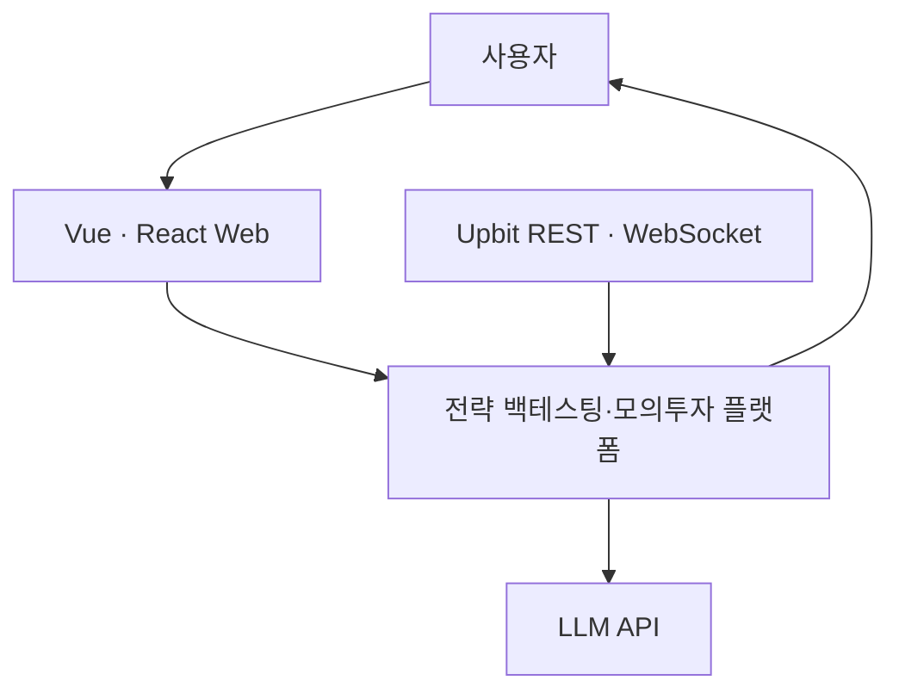

### 설계 이유

- Web은 계산 엔진이 아니라 입력·조회 화면이다.
- 플랫폼만 Upbit 응답을 내부 데이터 형식으로 변환한다.
- AI는 플랫폼 외부 의존성이며, AI 장애가 백테스트·모의투자를 중단시키면 안 된다.
- 사용자는 Upbit API나 데이터베이스에 직접 접근하지 않는다.

---

## 4. 목표 데이터 아키텍처 구조도

아래 구조도가 첨부 구조도를 대체하는 **MVP 기준 전체 구조도**다.

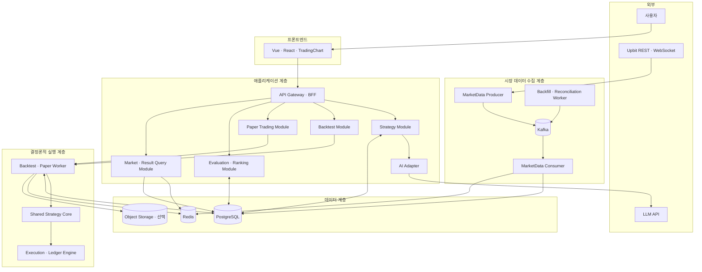

### 구조 해석

1. Upbit 데이터는 Producer가 수신하고 Kafka로 전달한다.
2. Consumer가 표준화된 시장 데이터를 PostgreSQL에 저장하고 최신 데이터만 Redis에 반영한다.
3. Web 요청은 BFF를 거쳐 담당 모듈로 이동한다.
4. Strategy Module은 AI Adapter를 사용할 수 있지만 최종 DSL 검증과 저장은 직접 수행한다.
5. Backtest와 Paper Trading은 동일 Worker, Strategy Core, Execution Engine을 사용한다.
6. PostgreSQL에는 재현에 필요한 원본과 버전을 저장한다.
7. Redis에는 차트 최신값, 실행 진행률, 최신 모의계좌 상태를 저장한다.
8. 대규모 상세 결과 파일이 생길 때만 Object Storage를 추가한다.

---

## 5. 첨부 구조도 대비 변경 사항

| 첨부 구조 | 목표 구조 | 변경 이유 |
| --- | --- | --- |
| `랭킹·체결·전략 수립 API` 하나 | Strategy, Paper, Ranking 모듈 분리 | 전략 작성, 주문 처리, 공식 평가의 책임이 다름 |
| `모의투자·백테스팅 API`가 별도 계산 | 공통 Worker와 Strategy Core 사용 | Historical/Realtime 신호 불일치 방지 |
| AI FastAPI가 중심 API로 전략 전달 | AI Adapter가 DSL 초안만 반환 | AI가 검증과 사용자 확인을 우회하지 못하게 함 |
| Redis에서 API로 직접 데이터 공급 | Redis 우선 조회 후 PostgreSQL fallback | 캐시 장애가 서비스 전체 장애가 되지 않게 함 |
| Consumer가 API와 DB에 동시에 전달 | Consumer는 저장·이벤트 발행 담당 | 저장 전 데이터가 화면이나 전략 실행에 노출되는 문제 방지 |
| `1분봉 누락 배치` | 타임프레임 공통 Reconciliation Worker | 기획 기준 1시간 봉과 구조도 간 불일치 제거 |
| DB 연결 화살표가 혼재 | 모듈별 R/W 경로 명시 | 데이터 소유권과 장애 원인을 추적하기 위함 |

---

## 6. 시장 데이터 쓰기 구조

### 6.1 실시간 Write Path

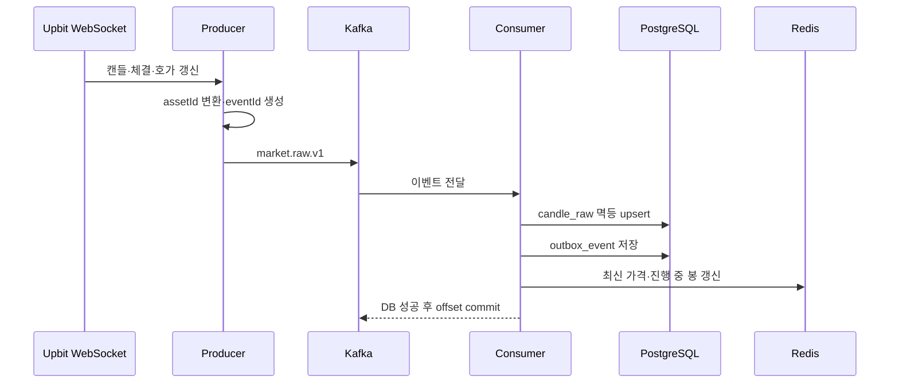

### 데이터 이동 규칙

| 구간 | 데이터 | 전달 방식 | 실패 시 처리 |
| --- | --- | --- | --- |
| Upbit → Producer | 거래소 원본 응답 | WebSocket | 재연결 후 REST 보충 |
| Producer → Kafka | 표준 MarketEvent | 비동기 | backoff 후 재발행 |
| Kafka → Consumer | 동일 market의 순서화 이벤트 | Consumer Group | offset부터 재처리 |
| Consumer → PostgreSQL | 원본 캔들·품질 상태 | 트랜잭션 | offset 미확정 |
| Consumer → Redis | 최신 시세·진행 봉 | cache update | DB 기준 재생성 |

### 핵심 키

```text
candle unique key
= exchange + assetId + timeframe + openTime

kafka partition key
= exchange + market + timeframe

market event id
= source + market + timeframe + openTime + sourceSequence
```

동일 시각의 WebSocket 캔들이 여러 번 오므로 INSERT 전용으로 처리하지 않고 복합 키 기준 upsert를 사용한다. 확정 봉 여부는 `isFinal`로 구분한다.

---

## 7. 누락 데이터 복구 구조

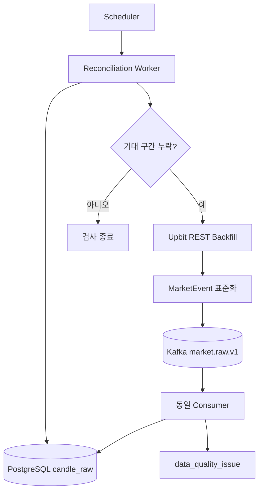

### 왜 Backfill이 DB에 직접 쓰지 않는가

실시간 수집과 배치 보충이 서로 다른 저장 코드를 사용하면 다음 문제가 발생한다.

- 가격·시간 변환 규칙이 달라질 수 있다.
- unique key와 품질 검사가 다르게 적용될 수 있다.
- 한쪽에만 버그 수정이 적용될 수 있다.

따라서 REST로 보충한 데이터도 같은 MarketEvent 계약과 Consumer 저장 경로를 사용한다. 이것이 DRY와 재현성 측면에서 핵심이다.

### 누락 상태 구조

| 상태 | 의미 | 지표 계산 | 모의 체결 |
| --- | --- | --- | --- |
| `OBSERVED` | 실시간 수신 원본 | 가능 | 가능 |
| `BACKFILLED` | REST 보충 원본 | 가능 | 시점 조건 충족 시 가능 |
| `NO_TRADE` | 실제 체결이 없어 봉 미생성 | 파생 봉 사용 가능 | 합성 가격 체결 금지 |
| `SOURCE_GAP` | 수집 장애로 값 불명 | 공식 평가 제외 | 금지 |
| `QUARANTINED` | 이상치 격리 | 금지 | 금지 |

---

## 8. 시장 데이터 Read Path

용도에 따라 조회 저장소를 다르게 사용한다.

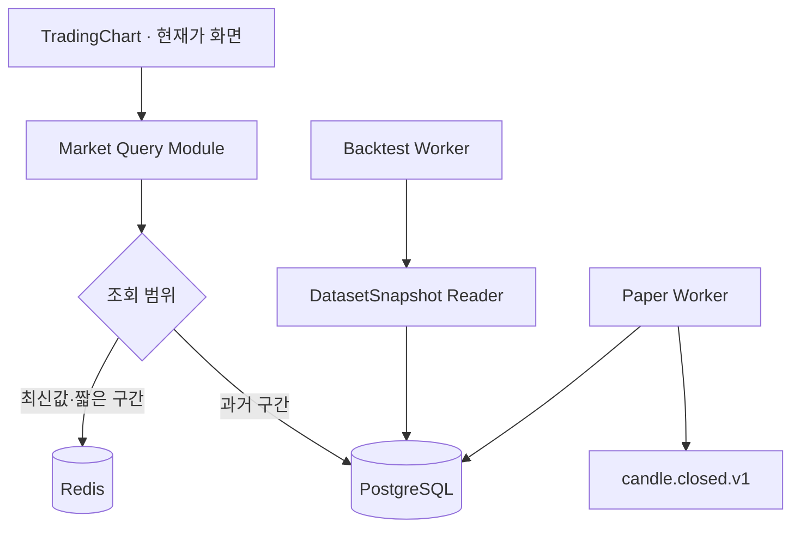

| 소비자 | Redis | PostgreSQL | Kafka |
| --- | --- | --- | --- |
| TradingChart | 최신값 우선 | 과거 차트·fallback | 직접 사용하지 않음 |
| Backtest Worker | 사용하지 않음 | 고정 스냅샷 조회 | 작업 요청만 사용 가능 |
| Paper Worker | 최신 표시 캐시 | 전략·원장 상태 | 확정 봉 트리거 |
| Ranking Worker | 사용하지 않음 | 표준 데이터·평가 결과 | 평가 Job 수신 |

백테스트가 Redis를 읽으면 TTL, 캐시 갱신 시점, 장애 복구에 따라 결과가 달라질 수 있다. 따라서 백테스트 입력은 PostgreSQL의 `dataset_snapshot`으로 고정한다.

---

## 9. 전략 생성 데이터 구조

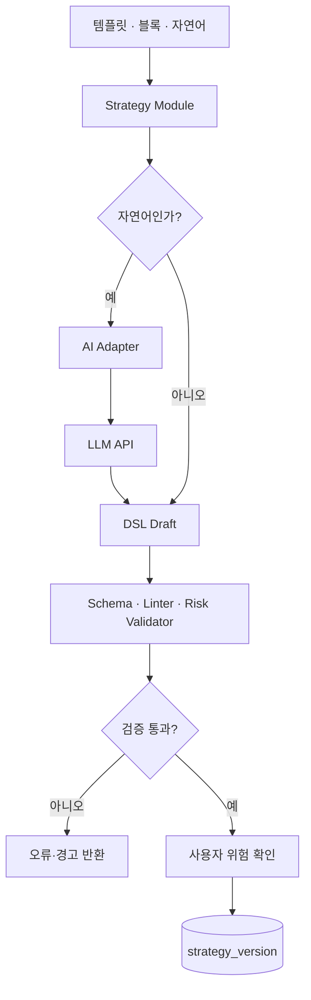

### 저장 데이터

| 테이블 | 핵심 데이터 | 변경 정책 |
| --- | --- | --- |
| `strategy` | 소유자, 이름, 공개 상태 | 메타데이터 변경 가능 |
| `strategy_version` | DSL, DSL 버전, 생성 시각 | 적용 후 불변 |
| `validation_report` | 오류, 경고, warm-up, 지원 엔진 | 버전별 저장 |
| `strategy_fork` | 복제 원본 버전, 복제 사용자 | 관계 불변 |

### AI Adapter의 데이터 경계

```text
입력  = 사용자 자연어 + 허용된 DSL Schema + 지원 블록 목록
출력  = DSL 초안 + 누락 질문 + 전략 설명
금지  = DB 저장, 지표 계산, 주문 생성, 모의투자 시작, 랭킹 공개
```

AI가 만든 DSL도 사용자가 블록으로 만든 DSL과 동일한 Validator를 거친다.

---

## 10. 백테스트 데이터 구조

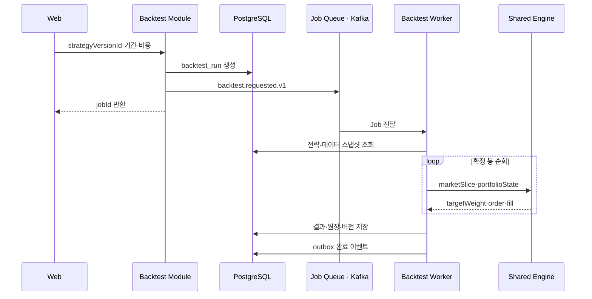

### BacktestRun 입력 묶음

```text
BacktestRun
├─ strategyVersionId
├─ datasetSnapshotId
├─ engineVersion
├─ universePolicyVersion
├─ executionModelVersion
├─ feeModelVersion
├─ initialCash
├─ startTime / endTime
└─ randomSeed
```

### Worker 데이터 흐름

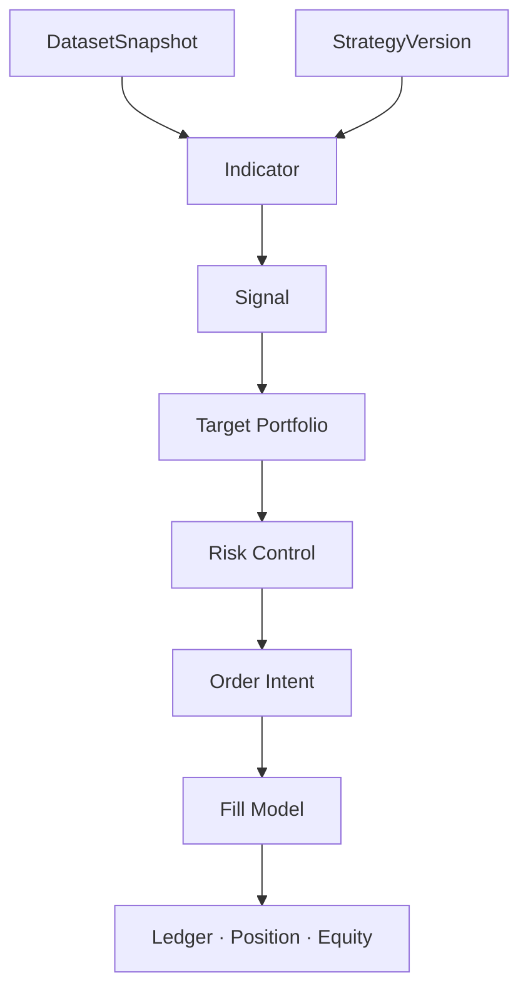

Strategy Core는 DB와 Redis를 직접 조회하지 않는다. Worker가 필요한 데이터만 입력 객체로 전달해야 같은 코어를 단위 테스트와 모의투자에서 재사용할 수 있다.

---

## 11. 모의투자 데이터 구조

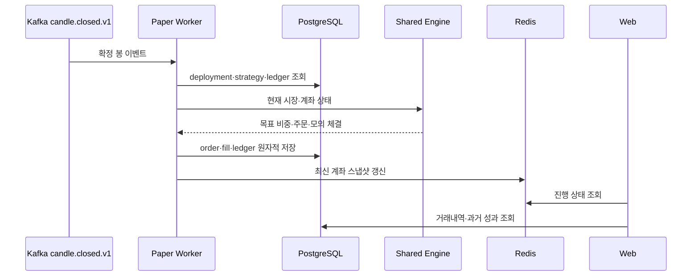

### 원장 쓰기 경계

아래 데이터는 하나의 DB 트랜잭션으로 저장한다.

```text
paper_event_processing
├─ processed marketEventId
├─ order
├─ fill
├─ ledger_entry
├─ position_snapshot
└─ equity_snapshot
```

멱등 키는 `(paperDeploymentId, marketEventId)`다. 같은 확정 봉이 재전달되어도 주문과 체결이 두 번 생성되지 않는다.

### 백테스트와 모의투자의 차이

| 항목 | 백테스트 | 모의투자 |
| --- | --- | --- |
| 시간 진행 | 과거 데이터를 빠르게 순회 | 확정 봉 이벤트마다 진행 |
| 시장 입력 | `datasetSnapshotId` | `candle.closed.v1` |
| 계좌 상태 | Worker 메모리 + 결과 저장 | PostgreSQL 원장 |
| 계산 코어 | Shared Strategy Core | Shared Strategy Core |
| 체결 코어 | Execution Engine | Execution Engine |

달라지는 것은 시간과 데이터 공급 Adapter뿐이며 전략 판단 코드는 동일하다.

---

## 12. 공식 평가·랭킹 데이터 구조

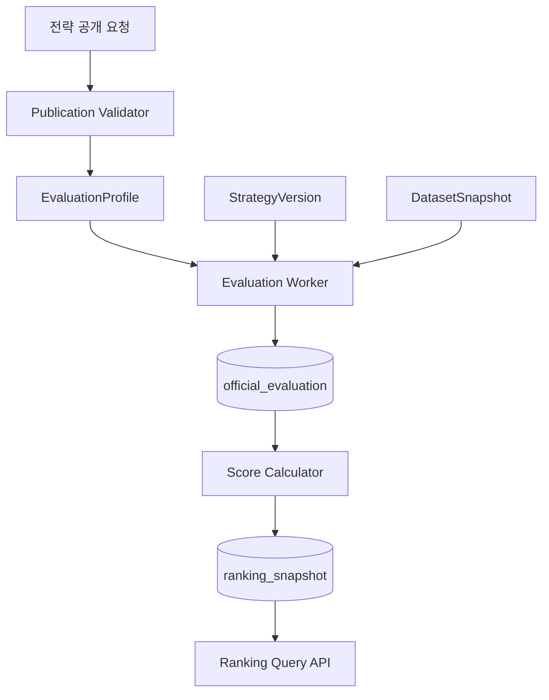

### 데이터 경계

| 데이터 | 자유 백테스트 | 공식 평가 |
| --- | --- | --- |
| 기간 | 사용자 선택 | EvaluationProfile 고정 |
| 종목 | 사용자 선택 | 시점별 Universe 고정 |
| 비용 | 사용자 선택 가능 | 동일 모델 버전 |
| 데이터 | 선택 가능한 적격 데이터 | 동일 DatasetSnapshot |
| 랭킹 반영 | 불가 | 검증 통과 결과만 가능 |

`ranking_snapshot`은 이전 순위를 UPDATE하지 않고 새 스냅샷을 생성한다. 이를 통해 특정 날짜의 순위와 당시 평가 조건을 다시 조회할 수 있다.

---

## 13. PostgreSQL 논리 스키마 구조

데이터베이스는 물리적으로 하나를 사용하되 논리 Schema 또는 패키지 경계로 소유권을 나눈다.

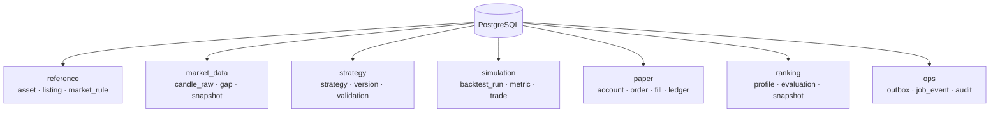

### Schema별 테이블

| Schema | 주요 테이블 | 쓰는 컴포넌트 | 읽는 컴포넌트 |
| --- | --- | --- | --- |
| `reference` | `asset`, `market_listing`, `market_rule_version` | Market Admin·Collector | 모든 Engine·Query |
| `market_data` | `candle_raw`, `candle_derived`, `data_gap`, `dataset_snapshot` | Market Consumer·Reconciler | Chart·Backtest·Evaluation |
| `strategy` | `strategy`, `strategy_version`, `validation_report` | Strategy Module | Engine·Ranking |
| `simulation` | `backtest_run`, `backtest_trade`, `result_metric` | Backtest Worker | Result Query |
| `paper` | `paper_account`, `paper_deployment`, `order`, `fill`, `ledger_entry` | Paper Worker | Paper Query·Audit |
| `ranking` | `evaluation_profile`, `official_evaluation`, `ranking_snapshot` | Evaluation Worker | Ranking Query |
| `ops` | `outbox_event`, `job_event`, `consumer_checkpoint` | 각 트랜잭션 소유 모듈 | Publisher·운영 도구 |

---

## 14. 핵심 ERD

시장 데이터와 전략 실행 관계만 표현한 최소 ERD다.

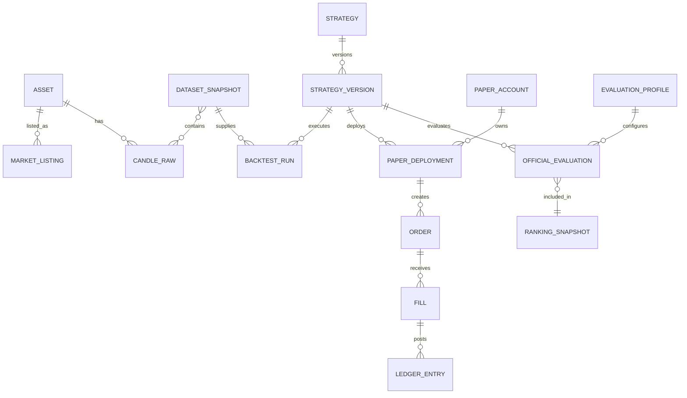

### 반드시 버전으로 연결할 값

```text
실행 결과
├─ strategyVersionId
├─ datasetSnapshotId
├─ engineVersion
├─ indicatorLibraryVersion
├─ universePolicyVersion
├─ executionModelVersion
├─ feeModelVersion
└─ metricFormulaVersion
```

이 값 중 하나라도 빠지면 동일 결과를 재현하기 어렵다.

---

## 15. Redis 데이터 구조

Redis는 영구 데이터 저장소가 아니라 재구축 가능한 조회·실행 보조 계층으로 제한한다.

| Key 패턴 | 자료구조 | 값 | TTL |
| --- | --- | --- | --- |
| `market:latest:{assetId}` | Hash | 최신 가격·시각·품질 | 짧게 설정 |
| `candle:current:{assetId}:{tf}` | Hash | 진행 중 봉 | 봉 종료 후 만료 |
| `candle:closed:{assetId}:{tf}` | String/Hash | 최신 확정 봉 | 조회 정책에 따라 설정 |
| `job:progress:{jobId}` | Hash | 상태·진행률·현재 단계 | Job 완료 후 만료 |
| `paper:snapshot:{accountId}` | Hash | 현금·포지션·평가금액 | 짧게 설정 |
| `ranking:latest:{profileId}` | String | 최신 rankingSnapshotId | 새 평가 시 교체 |

### Redis에 저장하지 않는 데이터

- 과거 전체 OHLCV의 유일한 사본
- StrategyVersion 원본
- 주문·체결의 유일한 사본
- 모의계좌 원장
- 공식 평가 결과의 유일한 사본

Redis 장애 시 PostgreSQL과 Kafka에서 다시 구성할 수 있어야 한다.

---

## 16. Kafka Topic 구조

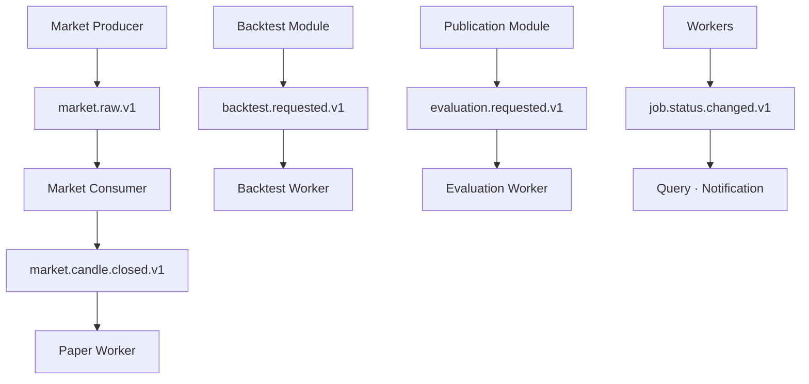

| Topic | Key | Producer | Consumer |
| --- | --- | --- | --- |
| `market.raw.v1` | 시장+주기 | Producer·Backfill | Market Consumer |
| `market.candle.closed.v1` | 시장+주기 | Market Consumer | Paper Worker |
| `backtest.requested.v1` | `jobId` | Backtest Module | Backtest Worker |
| `evaluation.requested.v1` | `evaluationId` | Publication Module | Evaluation Worker |
| `job.status.changed.v1` | `jobId` | Workers | Query·Notification |

### Kafka 설계 원칙

- Topic 이름에 Schema 버전을 포함한다.
- 동일 시장 이벤트의 순서를 위해 같은 market key를 같은 파티션으로 보낸다.
- Kafka의 exactly-once만 신뢰하지 않고 DB unique key로 멱등성을 보장한다.
- 처리 불가능한 이벤트는 원인과 재시도 횟수를 포함해 DLQ로 이동한다.
- DB 저장과 후속 이벤트 발행 사이의 유실을 막기 위해 Transactional Outbox를 사용한다.

---

## 17. 모듈별 저장소 접근 권한

| 모듈 | PostgreSQL | Redis | Kafka | 외부 API |
| --- | --- | --- | --- | --- |
| Market Producer | 체크포인트 최소 접근 | 사용 안 함 | W | Upbit R |
| Market Consumer | market_data W, ops W | W | R/W | 없음 |
| Strategy Module | strategy R/W | 선택적 R | 선택적 W | AI Adapter 경유 |
| Backtest Module | simulation W | progress R/W | W | 없음 |
| Backtest Worker | market_data R, strategy R, simulation W | progress W | R/W | 없음 |
| Paper Worker | market_data R, strategy R, paper R/W | snapshot W | R/W | 없음 |
| Evaluation Worker | market_data R, strategy R, ranking W | 사용 안 함 | R/W | 없음 |
| Query Module | 각 Read Model R | R | 사용 안 함 | 없음 |

서비스가 다른 모듈의 테이블을 임의 UPDATE하지 않도록 한다. 다른 영역의 상태 변경이 필요하면 소유 모듈의 애플리케이션 인터페이스 또는 이벤트를 사용한다.

---

## 18. 논리 구조와 실제 배포 구조

논리적으로 모듈을 분리하더라도 MVP부터 모든 모듈을 마이크로서비스로 배포할 필요는 없다.

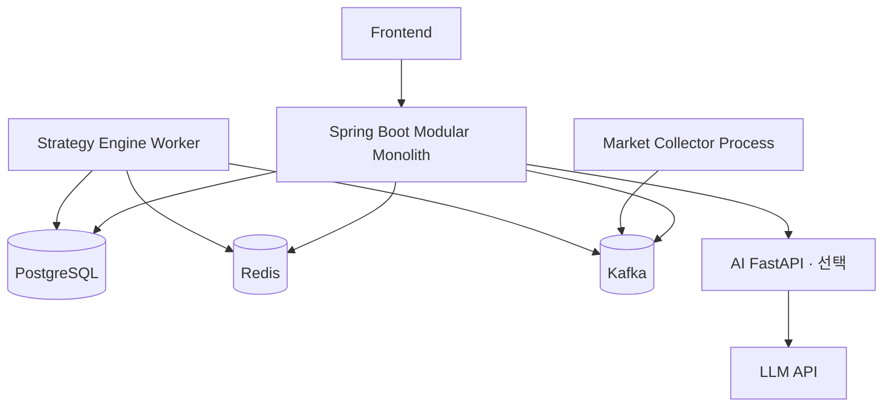

### MVP 배포 단위 권장

| 배포 단위 | 포함 책임 | 분리 이유 |
| --- | --- | --- |
| Frontend | Vue/React, TradingChart | 정적 UI 배포 |
| Spring Boot App | BFF, Strategy, Backtest Command, Paper Command, Ranking, Query | 트랜잭션과 개발 단순성 |
| Market Collector | REST/WebSocket 수집, 재연결 | 24시간 연결 생명주기 분리 |
| Strategy Engine Worker | Backtest·Paper·Evaluation 실행 | CPU 작업과 API 응답 자원 분리 |
| AI FastAPI | 자연어 → DSL 초안 | AI 의존성·배포 주기 분리 |

Strategy, Paper, Ranking을 구조도에서는 나누되 Spring Boot 내부 모듈로 시작한다. 처리량이나 팀 소유권이 실제로 분리될 때 서비스로 독립시킨다.

---

## 19. 주요 장애 시 데이터 경로

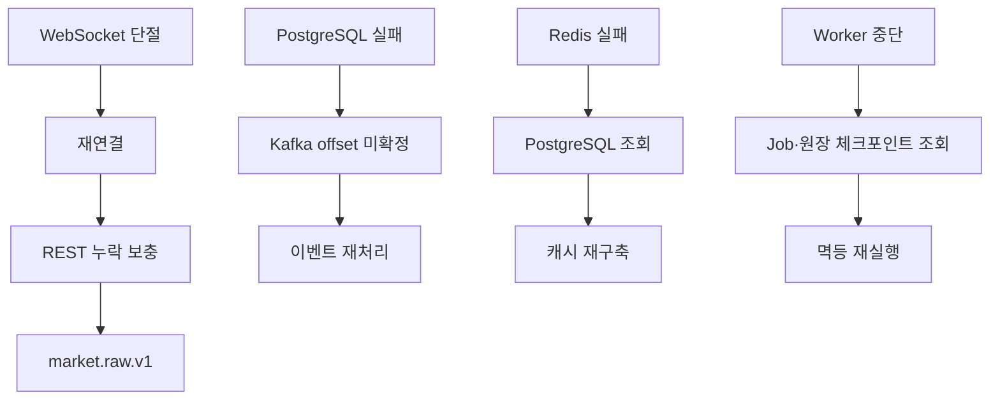

| 장애 | 손실되면 안 되는 데이터 | 복구 기준 |
| --- | --- | --- |
| Upbit 연결 단절 | 누락 시간 범위 | 마지막 정상 eventTime |
| Kafka 중복 | 주문·체결·캔들 | eventId와 unique key |
| PostgreSQL 장애 | 원장·전략·공식 결과 | 트랜잭션 롤백 후 재처리 |
| Redis 장애 | 없음 | PostgreSQL 기준 재생성 |
| Worker 재시작 | 처리 시점·계좌 상태 | jobId·deploymentId·marketEventId |

---

## 20. 구조 확정 전 P0 결정사항

| 결정 항목 | 권장안 | 구조 영향 |
| --- | --- | --- |
| 전략 엔진 언어 | 하나의 코어 구현만 유지 | 백테스트·모의투자 로직 중복 방지 |
| 숏 포지션 | 자유 실험만 허용, 공식 랭킹 제외 | 파생상품 원장·펀딩 모델을 MVP에서 제외 |
| 체결 시점 | 확정 봉 다음 봉 시가 | 같은 봉 종가 체결 룩어헤드 방지 |
| Universe | 시점별 과거 거래대금 상위 20개 | 생존자 편향 방지용 snapshot 필요 |
| Redis 장애 정책 | PostgreSQL fallback | 캐시를 기준 데이터로 사용하지 않음 |
| Kafka 유지 여부 | 모의투자·다중 Consumer가 있으면 유지 | 단일 Consumer PoC라면 단순 Queue로 시작 가능 |
| Object Storage | 상세 결과가 커질 때 추가 | MVP 초기 필수 아님 |

---

## 21. 최종 구조 요약

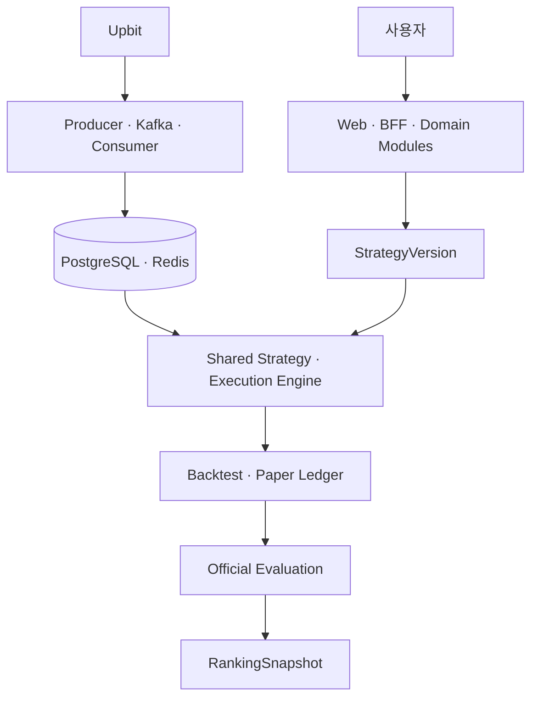

최종 구조는 다음 한 문장으로 정리할 수 있다.

> **Upbit 시장 데이터는 하나의 수집·정규화 경로로 저장하고, 불변 전략 버전과 고정 데이터 스냅샷을 공통 실행 엔진에 입력하며, 백테스트·모의투자·공식 평가 결과를 PostgreSQL 원장과 버전 식별자로 연결한다.**

