# 화면 설계 v1

AutoQuant 화면 목업 30종. 원본은 이 폴더의 HTML 파일이고, 아래 이미지는 1440px 기준 전체 페이지 캡처다.

- HTML을 직접 열어보려면 이 폴더를 클론한 뒤 브라우저로 열면 된다 (상위 폴더의 `styles.css` 참조)
- 번호 03, 13~15, 20~21, 34는 결번
- 핵심 사용자 여정: 홈 프롬프트 → 전략 빌더 → 백테스트 → 모의투자 리허설 → 대회 제출 → 채점 → 랭킹

## 목차

| 그룹 | 화면 |
|---|---|
| 인증, 계정 | 01 로그인, 28 계정 메뉴, 29 로그아웃 확인 |
| 홈, 차트 | 02 홈, 04 차트 |
| 전략 관리 | 05 목록, 23 빈 화면, 07~09 상세 |
| 전략 빌더 | 19 블록, 22 도움말, 27 저장 오류 |
| 백테스트 | 10 대기, 11 실행 중, 12 결과, 24 오류 |
| 모의투자 | 16 목록, 17 시작 모달, 18 실시간, 25 중지 |
| 랭킹 | 06 랭킹, 26 검색 결과 없음 |
| 대회 | 30 목록, 31 상세, 32 채점 중, 33 결과, 35 실격, 36 제출 확인 |
| 알림 | 37 알림 |

---

## 인증, 계정

### 01. 로그인

SSAFY 계정 SSO 로그인. 비밀번호는 저장하지 않음을 고지한다.

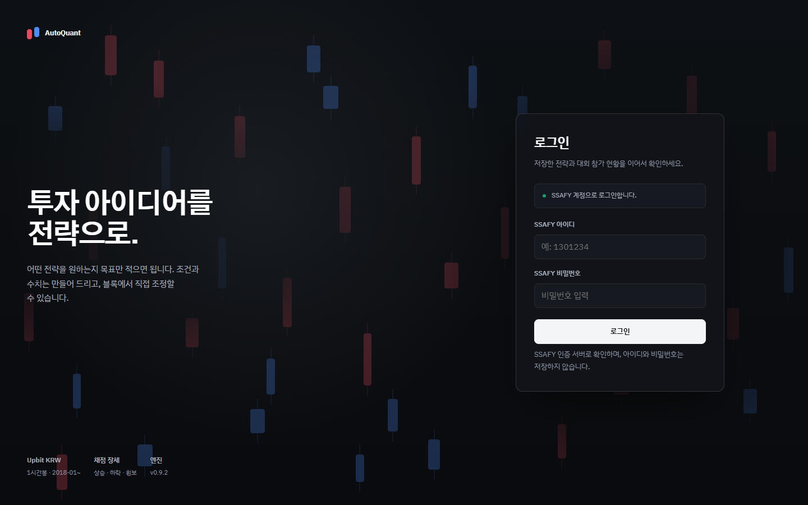

### 28. 계정 메뉴

아바타 드롭다운 — 계정 설정, 거래소(Upbit) 연결, 알림 설정, 로그아웃.

### 29. 로그아웃 확인

로그아웃해도 운용 중인 모의투자는 서버에서 계속 실행됨을 고지하는 모달.

---

## 홈, 차트

### 02. 홈 / 전략 만들기

서비스 메인 진입점. 자연어로 투자 목표를 입력하면 전략 초안을 생성한다.

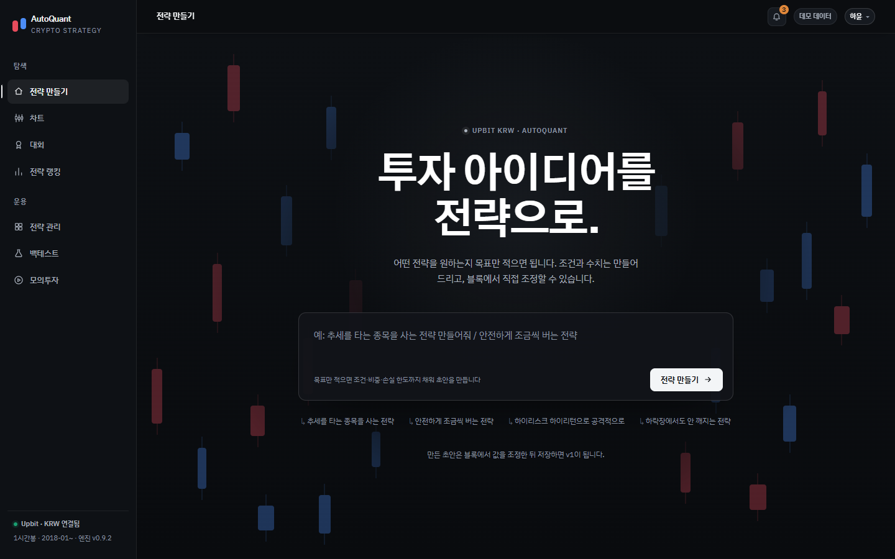

### 04. 차트

Upbit KRW 20종목, 9단계 타임프레임, MA·볼린저·거래량·RSI 지표, 호가창과 최근 체결.

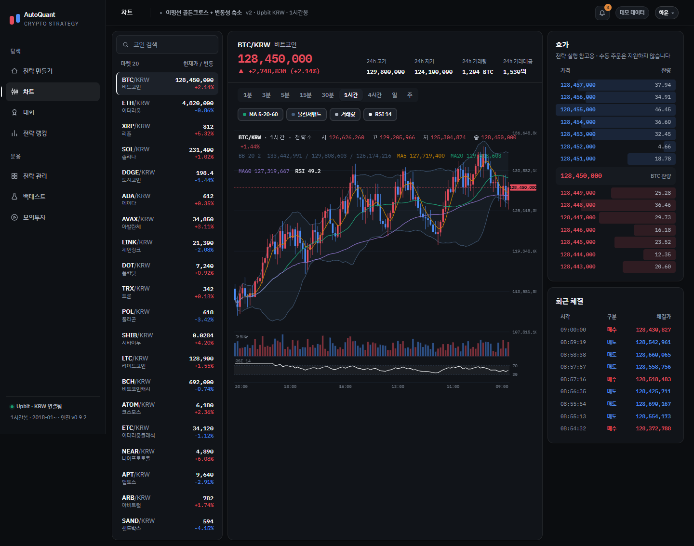

---

## 전략 관리

### 05. 전략 목록

내 전략 테이블. 단계 탭(초안 → 백테스트 완료 → 리허설 중 → 대회 제출)과 행별 "다음 할 일" 버튼.

### 23. 전략 목록 — 빈 화면

전략이 없을 때의 상태. 대화로 만들기 / 공개 전략 둘러보기로 유도.

### 07. 전략 상세 — 개요

공개 전략의 성과 탭. 지표 카드, 국면별 Calmar, 체결 표시 차트, 검증·대회 이력.

### 08. 전략 상세 — 전략 구성

진입·청산 / 자산 배분 / 위험 관리 / 실행 기준 4블록 규칙과 버전 이력.

### 09. 전략 상세 — 코드

읽기 전용 전략 DSL(JSON) 뷰어와 실행 환경(거래소·통화·주기·수수료·슬리피지).

---

## 전략 빌더

### 19. 전략 빌더 — 블록

자연어 해석 결과를 4블록(진입조건, 자산배분, 위험관리, 실행기준)으로 펼쳐 인라인 편집.

### 22. 전략 빌더 — 도움말

블록별 도움말 패널 오버레이.

### 27. 전략 빌더 — 저장 오류

비중 합계 초과(118% > 100%), 손실 한도 미입력 등 검증 실패 상태.

---

## 백테스트

### 10. 백테스트 — 대기

전략 선택과 설정 폼(기간, 주기, 초기자산, 수수료, 슬리피지, 유니버스).

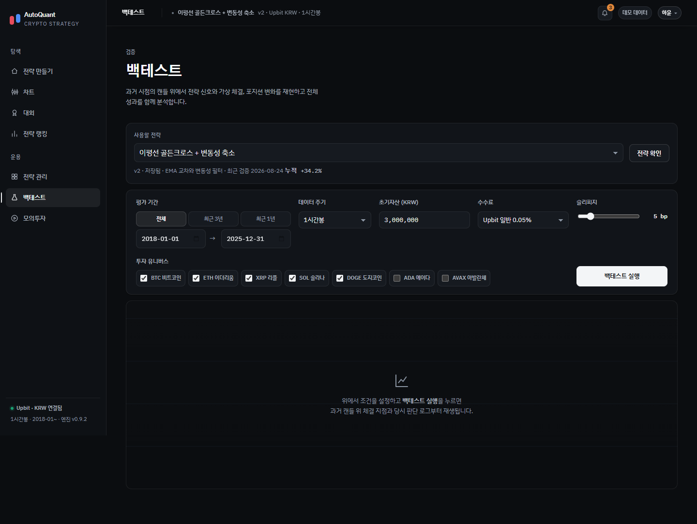

### 11. 백테스트 — 실행 중

실행 중 로딩 상태.

### 12. 백테스트 — 결과

성과 요약, 체결 리플레이 차트와 판단 로그, 누적수익·낙폭, 코인별 기여도, 비용 민감도, Forward Test(OOS).

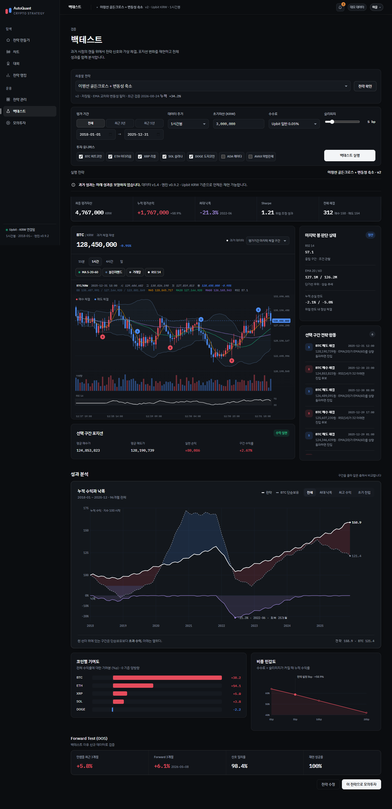

### 24. 백테스트 — 오류

캔들 부족 오류(`BT-412 / INSUFFICIENT_CANDLES`)와 복구 액션.

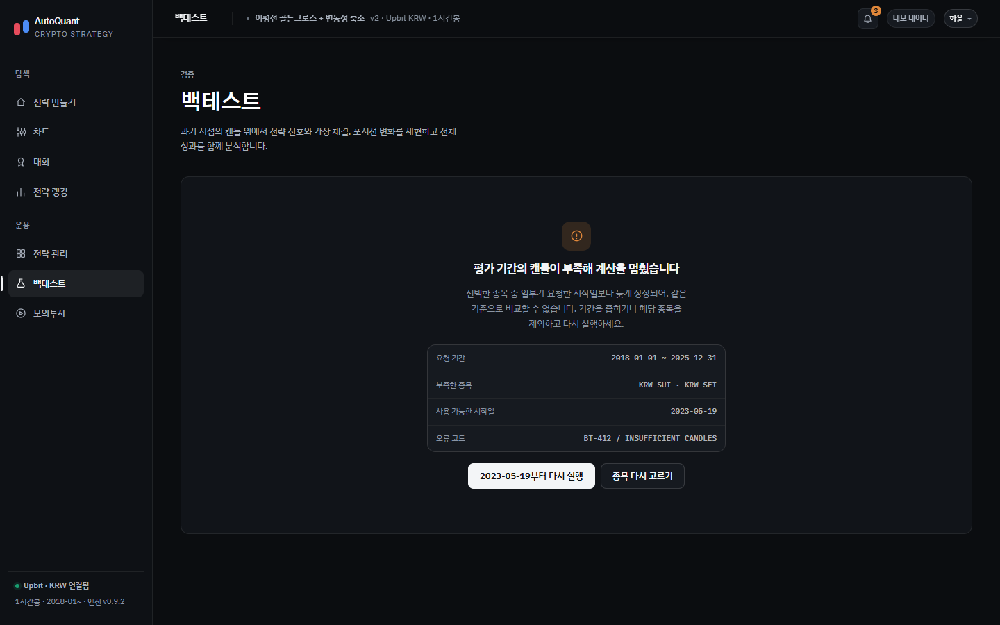

---

## 모의투자

### 16. 모의투자 — 목록

전략과 초기자산을 선택해 시작. 운용 중 카드에 수익곡선 스파크라인.

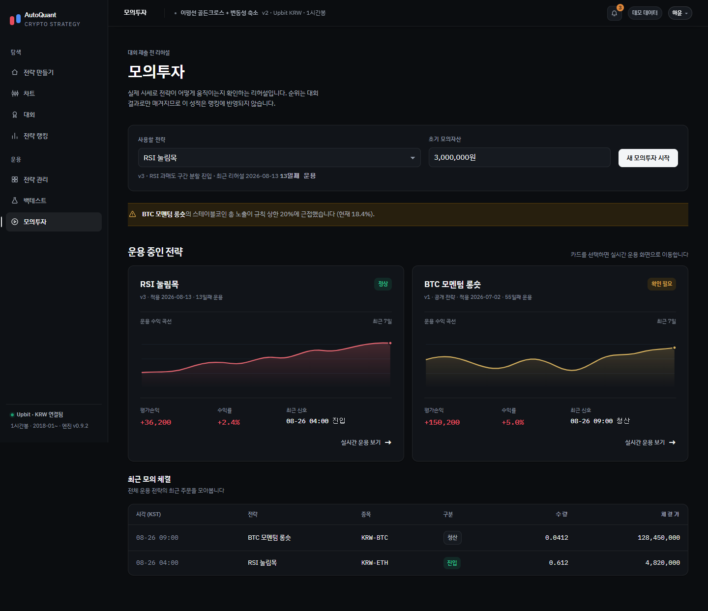

### 17. 모의투자 — 시작 모달

투자대상, 비중, 최대손실 규칙 확인과 동의 게이트.

### 18. 모의투자 — 실시간

평가자산, 포지션, 실시간 체결 원장(체결 근거 포함), 일일 손실 한도 게이지.

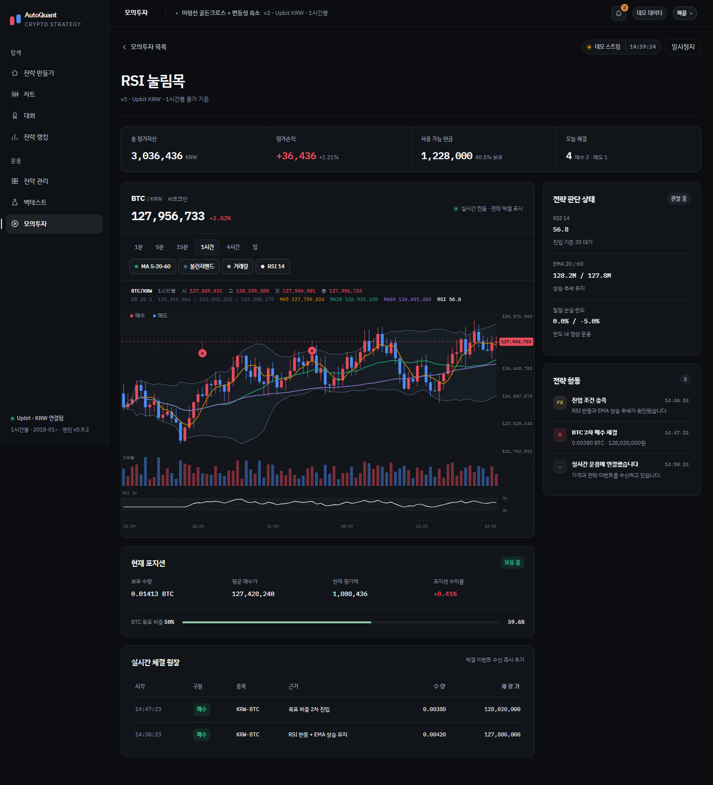

### 25. 모의투자 — 중지

일일 손실 한도(-5%) 도달로 자동 정지된 상태. 익일 자동 재개 안내.

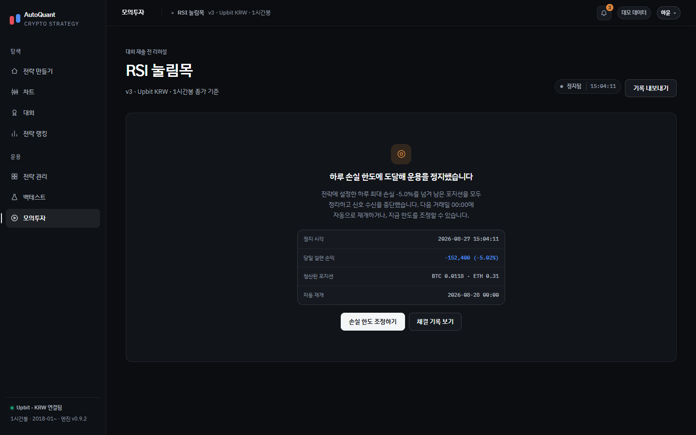

---

## 랭킹

### 06. 전략 랭킹

회차별 순위표(종합점수, 안정성, 국면별 백분위)와 필터, 전략 복제.

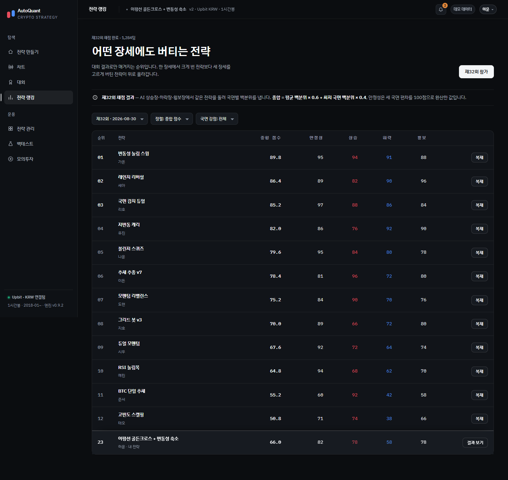

### 26. 랭킹 — 검색 결과 없음

필터 조건 미충족 상태.

---

## 대회

### 30. 대회 목록

진행 중 회차 히어로(참가수, 내 제출, 남은 교체, 마감 카운트다운)와 예정·지난 회차.

### 31. 대회 상세

국면별 내 전략 성적, 연습 점수 백분위, 채점 산식, 제출 패널.

### 32. 대회 — 채점 중

장세 생성 → 상승 → 하락 → 횡보 → 백분위·실격 판정 5단계 진행 상태.

### 33. 대회 결과

종합 점수와 순위, 국면별 성적, 점수 계산 과정, 1위와의 격차.

### 35. 대회 — 실격

하락장 MDD 상한(50%) 초과 실격 사유와 개선 가이드.

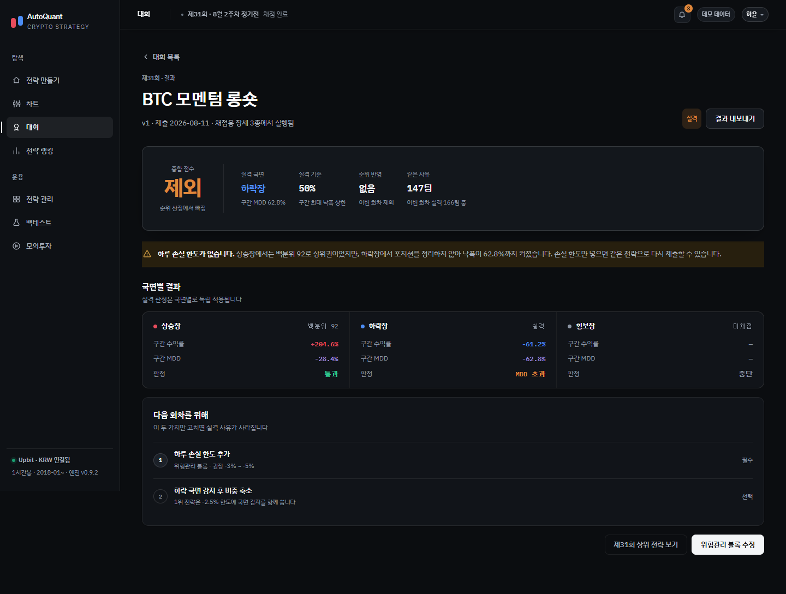

### 36. 대회 — 제출 확인

제출 시 버전 동결, 남은 교체 횟수 차감, 검증 주의사항 경고 모달.

---

## 알림

### 37. 알림

리허설 정지, 마감 임박, 채점 완료, 실격, 신규 회차, 저장 완료 6종 알림.

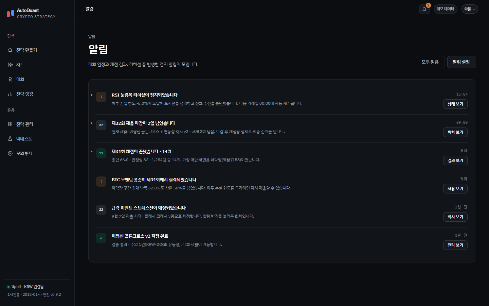
