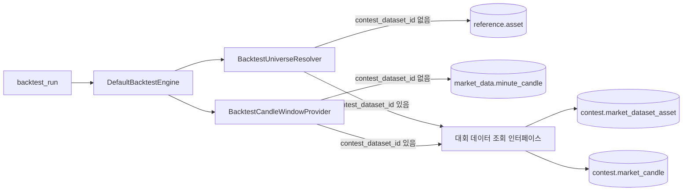

# 대회 기능 설계

결정 근거는 `docs/adr/`(ADR-0001~0014)에 있고, 대회 데이터 생성기 내부 결정(ADR-0008·0009·0011·0012)은 `ai/docs/adr/`에 있다. 이 문서는 무엇을 만들고 어떻게 연결하는지만 적는다.

## 1. 목표

참가자가 대회 회차에 전략을 제출하면, 마감 뒤 조작한 과거 데이터 4벌(일반장·상승장·하락장·횡보장)에서 백테스트하고 수익률 점수와 안정성 점수로 순위를 낸다.

## 2. 범위

| 넣는다 | 넣지 않는다 |
|---|---|
| 대회 데이터셋 저장, 대회 백테스트의 캔들·종목 경로 | 운영용 대회 데이터 생성 배치, 적재 API |
| 회차 조회, 전략 제출·교체 | 회차 생성·수정 관리자 API (로컬 적재 도구가 회차를 만든다) |
| 마감 후 채점, 결과·순위·데이터셋 공개 | 알림, 시즌 포인트, 결과 내보내기, 특별전 |
| 대회 화면 API 연결 | 연습 점수, 연습용 장세 (ADR-0001) |
| 생성기 출력을 넣는 Flyway 시드 마이그레이션 | 기존 엔진의 빈 시간 처리, 1원 미만 호가 |

## 3. 테이블

모두 `contest` 스키마다. 캔들 값 열의 타입은 `market_data.minute_candle`과 같다.

### contest_round — 대회 회차

| 열 | 내용 |
|---|---|
| `round_id` | UUID 기본 키 |
| `title` | 회차 이름 |
| `submission_starts_at`, `submission_ends_at` | 제출 시작과 마감. 시작이 마감보다 앞선다 |
| `phase` | `READY` · `SCORING` · `FINISHED`. 예정과 제출 중은 시각으로 계산한다(5절) |
| `max_submissions` | 제출과 교체를 합친 한도. 기본 5 (화면 설계 v1) |
| `warmup_weeks`, `evaluation_weeks` | 데이터셋 길이. 팩터 기간 상한을 여기서 계산한다 (ADR-0013) |
| `scoring_started_at`, `finished_at` | 채점 시작과 종료 시각 |

### market_dataset — 데이터셋 한 벌

| 열 | 내용 |
|---|---|
| `dataset_id` | UUID 기본 키 |
| `round_id` | 회차. (`round_id`, `kind`) 유일 |
| `kind` | `GENERAL` · `BULL` · `BEAR` · `SIDEWAYS` |
| `period_start`, `period_end` | 평가 구간 (가상 날짜) |
| `evaluation_return` | 평가 구간 균등 보유 수익률. 결과 화면의 시장 수익률 |
| `source_window_start`, `source_window_end` | 원본에서 고른 구간 |
| `seed`, `source_weeks` | 시드와 뽑은 주 목록 (원래 시작 시각, 라벨, 순서) |
| `generator_version`, `filled_hours` | 생성기 버전, 채운 빈 시간 수 |

### market_dataset_asset — 데이터셋 종목

(`dataset_id`, `asset_id`) 기본 키. `asset_id`는 `reference.asset`을 참조한다.

### market_candle — 데이터셋 캔들

(`dataset_id`, `asset_id`, `interval_minutes`, `open_time`) 기본 키. 간격은 60·240·1440분만 쓴다. 시가·고가·저가·종가, 거래량, 거래대금을 둔다. (`dataset_id`, `asset_id`)는 데이터셋 종목을 참조한다.

### contest_entry — 참가 제출

| 열 | 내용 |
|---|---|
| `entry_id` | UUID 기본 키 |
| `round_id`, `member_id` | (회차, 회원) 유일 |
| `strategy_id` | 제출 전략 |
| `submission_count` | 제출과 교체 횟수. 1 이상, 회차 한도 이하 |
| `first_submitted_at`, `last_submitted_at` | 첫 제출과 마지막 제출 시각 |

전략은 생성·조회·삭제만 있고 수정 API가 없어서, 전략 ID만 참조해도 제출 시점 내용이 고정된다. 제출 뒤 전략을 삭제해도 채점에는 쓴다.

### contest_evaluation — 제출 × 데이터셋 백테스트

(`entry_id`, `dataset_id`) 기본 키, `backtest_id` 유일. 채점 때 계산한 `average_exposure`(평균 투자 비중)를 둔다.

### contest_result — 제출별 점수

| 열 | 내용 |
|---|---|
| `entry_id` | 기본 키 |
| `return_score` | 일반장 누적 수익률 백분위 |
| `bull_mdd_percentile`, `bear_mdd_percentile`, `sideways_mdd_percentile` | 장세별 최대 낙폭 백분위 |
| `stability_score`, `total_score` | 안정성 점수, 총점 |
| `rank` | 실격이 아니면 순위 |
| `disqualification_reason`, `disqualified_kind` | `BACKTEST_FAILED` · `RETURN_BELOW_LIMIT` · `MDD_ABOVE_LIMIT` · `LOW_EXPOSURE`와 걸린 데이터셋 |

### 기존 테이블 변경

`trading.backtest_run.contest_dataset_id`: NULL 허용, `contest.market_dataset`을 참조한다 (ADR-0014).

## 4. 대회 백테스트 경로

- 대회 데이터 조회 인터페이스는 trading 패키지에 두고 contest 패키지가 구현한다.
- 대회 종목 후보는 데이터셋 종목 전체이고, 거래지원 기간은 보지 않는다.
- 엔진 입력 타입이 `MinuteCandle` 엔티티라서, 대회 캔들을 같은 타입으로 만드는 방법이 필요하다 (ADR-0014 결과).
- 대회 백테스트는 채점 서비스만 만든다. `GET /backtests`는 `contest_dataset_id`가 없는 백테스트만 보여 준다.
- 모의투자 경로는 바꾸지 않는다.

## 5. 회차 상태와 제출 규칙

| 화면 상태 | 조건 |
|---|---|
| 예정 `SCHEDULED` | `phase = READY`, 지금 < 제출 시작 |
| 제출 중 `OPEN` | `phase = READY`, 제출 시작 ≤ 지금 < 마감 |
| 채점 중 `SCORING` | `phase = SCORING`, 또는 `phase = READY`인데 마감이 지남 (스케줄러가 곧 채점을 시작한다) |
| 종료 `FINISHED` | `phase = FINISHED` |

제출과 교체는 아래 순서로 검증한다.

1. 회차가 있다. 없으면 `CONTEST-404-001`
2. 제출 중이다. 아니면 `CONTEST-409-001`
3. 본인의 삭제되지 않은 전략이다. 아니면 기존 `STRATEGY_NOT_FOUND`
4. 모든 팩터 기간이 상한 이하다. 1시간봉 `워밍업 시간 − 1`, 4시간봉 `워밍업 시간 ÷ 4 − 1`, 일봉 `워밍업 시간 ÷ 24 − 1`이고 워밍업 30주면 5,039·1,259·209다. 넘으면 `CONTEST-400-001`
5. 제출 횟수가 한도 미만이다. 아니면 `CONTEST-409-002`

같은 전략을 다시 제출해도 횟수에 넣는다.

## 6. 회차·제출 API

| 메서드·경로 | 응답 요지 |
|---|---|
| `GET /contests` | 진행 중·예정·지난 회차. 회차마다 상태, 제출 기간, 참가 수, 내 제출(전략 이름, 제출 횟수), 내 순위·총점, 1위 전략 이름·참가자 이름·총점. 채점된 제출이 있으면 마감 전에도 값이 있고 그때 순위는 잠정이다. 참가 수·내 결과·1위는 회차 수와 무관하게 한 번씩 읽는다 |
| `GET /contests/{roundId}` | 상태, 제출 기간, 채점 규칙 상수(가중치, 투자 비중 하한, 비용), 팩터 기간 상한, 제출 한도, 내 제출과 남은 횟수 |
| `PUT /contests/{roundId}/entry` | 요청 `strategyId`. 저장한 제출을 돌려준다 |

## 7. 채점

1. 제출·교체가 성공하면 그 자리에서 데이터셋 4벌의 대회 백테스트를 만든다. 교체하면 이전 평가와 점수를 버린다. 1분마다 도는 스케줄러(`contest.scoring.poll-interval`, 기본 1분)는 마감이 지난 `READY` 회차를 `SCORING`으로 바꾸고 아직 돌리지 않은 제출만 채운다. 비용은 초기 자본 1천만 원, 수수료 0.05%, 슬리피지 10bp이고 체결은 다음 봉 시가다. 기존 outbox와 worker를 그대로 탄다.
2. 같은 스케줄러가 백테스트가 끝난 제출의 점수를 저장한다. 마감 전에도 한다. 점수는 절대값이라 제출별로 확정되고, 순위는 그때까지 채점된 제출 사이의 자리라 참가자가 늘면 바뀐다.
3. 마감이 지나고 모든 백테스트가 끝나면 회차를 `FINISHED`로 바꾼다. 제출이 하나도 없으면 바로 종료한다.

제출이 처음 채점되면 그 회차 알림(`CONTEST_SCORED`) 하나를 보낸다. `targetId` 는 회차다. 대회 백테스트는 제출 하나에 4벌이라 백테스트 완료·실패 알림을 내지 않는다. 대회 백테스트는 연습 백테스트 조회 API(`GET /backtests/{id}` 와 결과·체결·자산)로도 열지 않는다. 체결의 종목·시각·가격이면 채점용 데이터의 가격 경로를 되짚을 수 있다 (ADR-0010).

점수는 ADR-0002, ADR-0003을 따른다.

- **실격.** 백테스트가 실패한 데이터셋이 있거나 일반장 평균 투자 비중이 30% 미만이면 실격이다. 데이터셋을 일반장·상승장·하락장·횡보장 순으로 보며 처음 실패한 데이터셋 하나를 남기고, 네 벌이 모두 끝났으면 투자 비중을 본다. 크게 잃거나 깊이 빠진 전략은 실격이 아니라 아래 점수가 0점으로 내려간다(2026-09-17, S15P21A107-249).
- **수익률 점수.** 일반장에서 시장보다 얼마나 더 벌었는지. `((누적 수익률 − 일반장 시장 수익률) + 0.3) ÷ 0.6 × 100`을 0~100으로 자른다. 시장과 같으면 50점이다.
- **국면 점수.** `((시장 낙폭 − 구간 최대 낙폭) + 0.3) ÷ 0.6 × 100`을 0~100으로 자른다. 시장만큼 빠지면 50점이다. 시장 낙폭은 그 데이터셋 평가 구간 균등 보유의 최대 낙폭을 전략과 같은 봉 간격으로 잰 값이다(`contest.market_dataset.market_mdd_1h`·`_4h`·`_1d`).
- **안정성 점수.** 상승·하락·횡보 국면 점수의 `평균 × 0.6 + 최저 × 0.4`.
- **총점.** `수익률 점수 × 0.5 + 안정성 점수 × 0.5`. 순위는 총점이 높은 순이다.
- **평균 투자 비중.** 일반장 자산 추이의 시점마다 `1 − 현금 ÷ 총자산`을 구해 평균한다.

참고 구현과 기대값은 `ai/scripts/contest_sim/scoring.py`와 ADR-0012 결과다. 백엔드 점수 계산기(`ContestScoreCalculator`)는 2026-09-15 로컬 대회 재실행 성적에 1회차 4시간봉 시장 낙폭을 넣어 참고 구현과 같은 값(1~3위 총점 71.1 / 63.05 / 51.5, 순위 8개·실격 2개)을 내는 테스트로 고정한다.

## 8. 결과 API

| 메서드·경로 | 응답 요지 |
|---|---|
| `GET /contests/{roundId}/progress` | 회차 전체의 끝난 백테스트 수와 전체 수 |
| `GET /contests/{roundId}/results` | 순위, 전략 이름, 참가자 이름, 총점, 수익률·안정성 점수. 실격 제출은 순위 뒤에 사유와 함께. 마감 전에는 잠정 순위다 |
| `GET /contests/{roundId}/results/me` | 내 제출의 백테스트 진행 수, 데이터셋별 수익률·최대 낙폭·평균 투자 비중·체결 수·시장 수익률·시장 낙폭(내 전략 봉 간격 기준), 점수와 국면 점수, 실격 사유, 참가 수, 1위 총점. 채점 중에는 점수 자리가 비어 있다. 종료 후에는 데이터셋별 자산 곡선(하루 한 점 누적 수익률)이 붙는다 |
| `GET /contests/{roundId}/rankings` | 순위 한 페이지. 정렬(총점·안정성), 국면 강점 필터, 전략 이름 검색을 받는다 |
| `GET /contests/{roundId}/datasets` | 종료 후: 종류, 평가 기간, 원본 구간, 뽑은 주, 시드, 시장 수익률 (ADR-0010) |

참가자 이름은 회원 이름(SSAFY 로그인이 준 실명)이라 다른 참가자 이름은 첫 글자와 마지막 글자만 남기고 가린다(`박민용` → `박*용`, 두 글자면 `가*`). 내 제출은 그대로 보인다. 이름으로 검색하면 가린 실명이 드러나 순위표 검색은 전략 이름만 본다.

채점용 데이터의 출처(`datasets`)만 종료 후에 열린다. 그 전에 요청하면 `CONTEST-409-003`이다 (ADR-0010).

## 9. 화면 연결

| 화면 (설계 v1) | API | v1과 달라지는 점 |
|---|---|---|
| 30 대회 목록 | `GET /contests` | "이번 회차 장세(연습용)" 영역을 뺀다. 채점 기준 문구를 수익률·안정성으로 바꾼다 |
| 31 대회 상세 | `GET /contests/{roundId}`, `PUT …/entry` | 국면별 연습 성적과 연습 점수 영역을 뺀다. 채점 산식을 ADR-0003으로 바꾸고 팩터 기간 상한을 안내한다 |
| 36 제출 확인 | `PUT …/entry` | 남은 횟수, 마감, "채점용 데이터는 마감 후 공개"를 보여 준다 |
| 32 채점 중 | `GET …/progress` | 5단계 표시 대신 끝난 백테스트 비율을 보여 준다 |
| 33 결과 | `GET …/results/me`, `GET …/datasets` | Calmar 대신 수익률 점수·안정성 점수와 장세별 국면 점수를 보여 준다. 낙폭은 시장 낙폭과 나란히 둔다. 표준편차 기반 안정성 표기는 뺀다 |
| 35 실격 | `GET …/results/me` | 실격 사유 두 가지(백테스트 실패, 투자 비중 미달)와 걸린 데이터셋을 보여 준다 |

결과 화면은 목업 33의 장세 카드 곡선(`regime-spark`)과 비교 막대(`pct-track`)를 쓴다. 곡선은 종료 후에만 그린다. 전 종목을 들고 있는 전략의 일별 곡선이면 평가 13주를 실제 과거와 맞춰 뽑은 주를 역산할 수 있어서다(ADR-0010). 시장 대비 수익률·낙폭 막대는 이미 공개된 숫자라 마감 전에도 보인다. 대회 백테스트 ID는 응답에 싣지 않는다. 체결 조회로 종목별 가격 경로가 드러난다.

화면 마크업 작업 S15P21A107-166과 범위가 겹치므로 담당자와 나눠 진행한다.

## 10. 로컬 대회 데이터 준비

대회 데이터는 운영 배치 없이 로컬에서 생성기로 만들고, 회차마다 Flyway 마이그레이션 한 장으로 넣는다 (ADR-0016). 마이그레이션은 `ai/scripts/contest_sim/export_seed_sql.py`가 생성기 출력에서 만든다. 절차는 `ai/docs/PLAN-CONTEST-DATA.md` 4.3절에 있다.

## 11. 작업 순서

| 순서 | Jira | 작업 |
|---|---|---|
| 1 | [S15P21A107-223](https://ssafy.atlassian.net/browse/S15P21A107-223) | [BE] 대회 데이터셋 저장과 대회 백테스트 캔들·종목 경로 |
| 2 | [S15P21A107-221](https://ssafy.atlassian.net/browse/S15P21A107-221) | [AI] 대회 데이터를 contest 테이블에 넣는 로컬 적재 도구 |
| 2 | [S15P21A107-224](https://ssafy.atlassian.net/browse/S15P21A107-224) | [BE] 대회 회차 조회와 전략 제출 API |
| 3 | [S15P21A107-225](https://ssafy.atlassian.net/browse/S15P21A107-225) | [BE] 대회 채점과 결과 API |
| 4 | [S15P21A107-226](https://ssafy.atlassian.net/browse/S15P21A107-226) | [FE] 대회 목록·상세·제출·결과 화면 API 연결 |
| 병행 | [S15P21A107-222](https://ssafy.atlassian.net/browse/S15P21A107-222) | [AI] 대회 장세 데이터 모양 조정과 3·4단계 검증 |

에픽은 BE·FE가 [S15P21A107-220](https://ssafy.atlassian.net/browse/S15P21A107-220), AI가 [S15P21A107-215](https://ssafy.atlassian.net/browse/S15P21A107-215)다.

## 12. 정한 것과 열린 결정

2026-09-17에 정했다.

- **제출 한도는 5회로 유지한다.** 제출하는 대로 점수가 나와서(ADR-0010 개정) 횟수가 많을수록 채점용 데이터에 맞춰 고치는 반복이 쉬워진다. 줄이면 규칙을 잘못 읽었거나 팩터 기간을 넘긴 실수를 고칠 기회가 모자란다. 5회면 실수 한두 번을 고치고도 맞춰 가며 다듬기에는 짧다. 교체하면 이전 점수를 버리고 마지막 제출만 채점한다.
- **회차 길이는 평가 13주, 워밍업 30주다** (ADR-0013). 팩터 기간 상한은 1시간봉 5,039, 4시간봉 1,259, 일봉 209다.
- **제출 기간은 회차 마이그레이션이 정한다.** 기간 규칙을 코드에 두지 않는다. 1회차는 2026-09-16 00:00 UTC부터 2026-09-20 15:00 UTC(21일 00:00 KST)까지다.
- **채점 비용은 초기 자본 1천만 원, 수수료 0.05%, 슬리피지 10bp, 다음 봉 시가 체결이다.** 수수료는 업비트 원화 마켓 기본 수수료와 같다. 슬리피지는 연습 백테스트 기본값(5bp)보다 크게 둬 잦은 매매로 점수를 올리기 어렵게 했다. 값은 `ContestScoringPolicy`에 있고 회차 상세 API가 그대로 보여 준다.
- **순위표의 다른 참가자 이름은 가린다** (S15P21A107-243). 회원 이름이 SSAFY 로그인이 준 실명이라서다. 첫 글자와 마지막 글자만 남기고 내 제출은 그대로 보인다. 순위표 검색은 전략 이름만 본다. 닉네임 기능이 생기면 가리지 않고 그 값을 쓴다.
- **회차는 서로 독립이다.** 한 회차가 끝나도 다음 회차가 이어서 열리지 않는다. 다음 회차는 데이터를 만들어 마이그레이션으로 따로 연다. 그 사이 대회 화면은 "현재 열린 대회가 없습니다"로 둔다. 지난 회차 점수와 순위는 다음 회차에 아무 영향을 주지 않는다. 채점·제출 한도·팩터 기간 상한이 모두 회차별이라 회차를 더 열어도 서로 섞이지 않는다.
- **시즌 포인트는 두지 않는다.** 회차마다 장세와 시장이 달라 점수를 그대로 더하면 공정하지 않다. 순위는 회차 안에서만 매긴다.
- **국면 점수는 시장 낙폭 대비로 잰다** (S15P21A107-240, ADR-0003 개정). 실격선 50%로 재면 1회차 장세에서 시장과 똑같이 움직인 전략이 하락장 0점, 나머지 20~30점대에 깔렸다.
- **수익률 −30% 미만·최대 낙폭 50% 초과 실격을 없앤다** (S15P21A107-249, ADR-0003 개정). 1회차 하락장은 시장 낙폭이 51.5%라 시장을 들고만 있어도 실격이었다. 크게 망가진 전략은 시장 대비 점수가 0점으로 내려가 실격 없이도 순위가 바닥이다. 백테스트 실패와 투자 비중 미달 실격은 남긴다.

### worker 처리 시간

2026-09-17 로컬에서 쟀다. API 1대, `backtest-worker` 1대(리스너 동시 실행 1), 1회차 데이터(종목 10개, 평가 13주)다. 12명이 1시간봉·4시간봉·일봉 전략을 4명씩 연달아 제출했다.

| 전략 봉 | 백테스트 실행(평균) | 건 사이 간격(평균) | 제출 1건(데이터셋 4벌) |
|---|---|---|---|
| 1시간봉 | 1.4초 | 약 5초 | 약 26초 |
| 4시간봉 | 0.3초 | 약 1.2초 | 약 6초 |
| 일봉 | 0.15초 | 약 0.5초 | 약 3초 |

- 48건이 첫 요청부터 마지막 완료까지 132초 걸렸다. 제출 1건에 평균 11초다.
- 실행 시간은 `completed_at − started_at`이고, 건 사이 간격은 앞 건 완료부터 다음 건 시작까지다. 간격이 실행보다 길어 제출 1건 시간은 간격이 좌우한다.
- 마감 직전 100명이 모두 1시간봉으로 내면 worker 1대로 약 45분 밀린다. 대회 백테스트는 연습 백테스트와 같은 큐를 써서 그동안 연습 백테스트도 기다린다.
- 참가 규모가 수십 명인 지금은 worker 1대로 둔다. 참가가 늘면 worker를 더 띄운다. 큐 소비자가 늘 뿐 코드는 바뀌지 않는다.

### 열린 결정

- 대회 데이터 품질(장세 낙폭, 2단계 통과 기준)은 S15P21A107-222에서 정한다.
