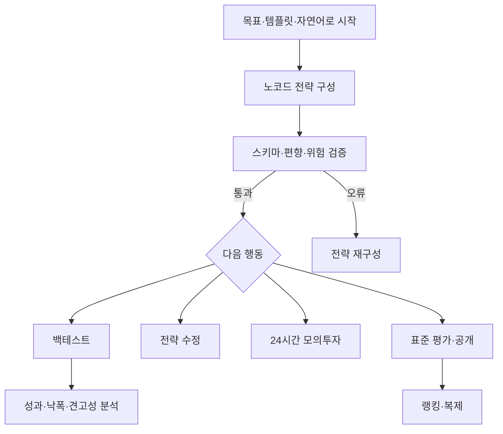

# 코인 투자 전략 백테스팅·모의투자 서비스 기획서

## 1. 서비스 한 문장 정의

사용자가 코딩 없이 코인 투자 전략을 구성하고, 과거 데이터 백테스트와 24시간 모의투자로 검증한 뒤, 동일한 시장 조건에서 전략 품질을 비교하는 서비스다.

---

## 2. 문제 정의

### 사용자가 겪는 문제

- 투자 아이디어는 있지만 Python이나 트레이딩 봇 코드를 작성할 수 없다.
- RSI, 이동평균 같은 진입 지표만 조합하고 비중·청산·위험·비용은 빠뜨린다.
- 과거 전체 데이터를 지표 계산에 사용해 미래 정보를 본 것처럼 결과가 왜곡된다.
- 거래소 수수료, 호가 스프레드, 최소주문금액, 주문 정밀도를 반영하지 않는다.
- 24시간 시장인데 일봉 기준 시각과 타임존이 달라 결과가 달라진다.
- 상승장 일부만 골라 백테스트한 전략이 랭킹 상위에 올라간다.
- 백테스트 이후 새로운 시장 데이터로 검증하는 Forward Test가 없다.

### 목표 사용자

| 사용자 | 필요 기능 |
| --- | --- |
| 코인 투자 입문자 | 목표형 마법사, 안전한 기본값, 용어 설명, 위험 경고 |
| 비개발 투자자 | 자연어 → 블록 초안, 템플릿 수정, 백테스트 |
| 퀀트 입문자 | 상세 파라미터, 전략 버전 비교, 민감도 분석, DSL 보기 |
| 전략 탐색 사용자 | 공개 전략 랭킹, 모의투자 이력, 복제, 변경점 비교 |

### 제품 원칙

1. 과거 성과를 미래 성과 보장으로 표현하지 않는다.
2. 점수와 함께 산식, 평가기간, 데이터·엔진 버전, 신뢰도를 공개한다.
3. 전략 버전은 적용·공개 후 불변으로 유지한다.
4. 모의투자 적용 전 전략의 투자대상·비중·최대손실 규칙을 사용자가 확인한다.
5. 유동성이 부족하거나 데이터가 불완전한 코인은 공식 평가에서 제외한다.

---

## 3. 전략 선택 기준

| 기준 | 설명 | MVP 결정 |
| --- | --- | --- |
| 시장·투자대상 (Universe) | 어떤 거래소와 자산을 대상으로 하는가 | 원화/달러, 코인 20종목을 거래대금 순으로 구성 |
| 신호 (Signal) | 어떤 가격·거래량·지표 조건을 투자 기회로 보는가 | 전략별 조건 블록으로 구성 |
| 자산배분 (Portfolio) | 선택된 코인과 현금을 어떤 비중으로 보유하는가 | 사용자 선택 |
| 위험관리 (Risk) | 손실·변동성·집중도·스테이블코인·거래소 위험을 어떻게 제한하는가 | AI가 초안을 제안하고 사용자가 확인 |
| 실행 (Execution) | 어느 주기와 체결 모델로 주문을 시뮬레이션하는가 | 사용자 선택 |

---

## 4. MVP 범위

전략을 선택하고 백테스팅을 진행한 뒤, 표준 조건에서 전략을 비교하고 랭킹에 공유한다.

| 항목 | MVP 결정 |
| --- | --- |
| 기준 거래소 | Upbit KRW 마켓을 1순위로 사용한다. 데이터 약관 검토 실패 시 다른 공식 공급자로 교체한다. |
| 기준통화 | KRW. 이후 USDT 마켓으로 확장한다. |
| 포지션 | 롱, 숏 |
| 데이터 주기 | 1시간 봉. 2018년 1월 1일 데이터부터 수집한다. 전략에 따라 시작 시점은 조정할 수 있다. |
| 전략 적용 | 서비스 내부 모의투자만 지원한다. |
| 랭킹 | 단일 거래소·기준통화·평가기간·비용모델로 표준화한다. |
| 백테스팅 | DB 데이터 기반으로 실행하며 종목과 기간은 사용자가 선택할 수 있다. |
| 백테스팅 랭킹 | 전략 공유를 목적으로 제공한다. |

---

## 5. 설계 원칙

1. 노코드 화면과 실행 엔진은 같은 JSON DSL을 사용한다.
2. AI는 DSL 초안과 설명만 만들고, 계산·검증·체결은 결정론적 엔진이 담당한다.
3. 사용자 자유 백테스트와 공식 랭킹 평가를 분리한다. 종목과 기간이 다르면 성과를 공정하게 비교할 수 없다.
4. 백테스트와 모의투자는 같은 전략 코어를 공유한다. 데이터 공급자와 시간 진행 방식만 다르게 구성한다.
5. 코인을 심볼 문자열로만 식별하지 않는다. 거래소, 마켓, 기준통화, 거래지원 기간을 포함한 내부 `assetId`로 관리한다.
6. 24시간 시장의 시간 경계를 고정한다. 내부 저장·계산은 UTC, 사용자 화면은 KST를 기본으로 한다.
7. 스테이블코인은 현금이 아니다. USDT 등은 디페깅과 발행자 위험을 가진 자산으로 취급한다. Upbit KRW MVP에서 현금은 KRW 원장 잔액이다.

---

## 6. 레퍼런스 분석

### 6.1 `gs-quant`에서 참고할 개념

Goldman Sachs의 `gs-quant`는 정량금융, 파생상품, 리스크와 전략 개발을 위한 Python 툴킷이다. 코인 전용 전략 프레임워크는 아니며 일부 API는 기관용 접근이 필요하므로, 직접 엔진으로 채택하지 않고 전략 조립 구조만 참고한다.

- `Strategy`가 여러 `Trigger`를 소유하는 구조
- 조건인 `Trigger`와 동작인 `Action`의 분리
- 시장 데이터 조건과 리스크 조건의 조합
- 데이터 소스 추상화
- 거래비용 모델 명시
- 직렬화 가능한 전략 객체와 엔진 지원 여부 검증

즉, `gs-quant`는 전략 종류를 가져오는 곳보다 **전략을 객체와 규칙으로 조립하는 설계 참고자료**로 활용한다.

### 6.2 Freqtrade

Freqtrade는 코인 거래 봇으로 백테스트, dry-run, 거래소 연동, 전략 최적화 기능을 제공한다. 전략 구성 요소를 다음과 같이 나눈다.

- OHLCV 캔들
- 지표
- 진입 신호
- 청산 신호·최소 ROI
- 고정·트레일링 손절
- 가격 결정
- 포지션 조정

전체 DataFrame을 백테스트에 전달할 때 미래 데이터 참조가 발생하기 쉽다는 점과 이를 점검하는 lookahead analysis 및 recursive analysis 기능을 참고한다.

#### 본 서비스에 적용할 점

- 진입과 청산을 별도 블록으로 구성한다.
- 백테스트와 dry-run에 해당하는 모의투자를 연속된 검증 단계로 제공한다.
- 거래소별 최소주문금액과 정밀도 제한을 반영한다.
- 룩어헤드 분석을 공식 게시 전 필수 검사로 사용한다.
- 거래쌍 allowlist와 denylist를 지원한다.

### 6.3 Hummingbot

Hummingbot V2는 시장 데이터를 읽고 판단하는 `Controller`와 주문·포지션의 생명주기를 관리하는 `Executor`를 분리한다. 본 서비스에도 다음과 같은 책임 분리를 적용한다.

- 전략 DSL: 왜 거래할 것인가
- 실행 정책: 목표 비중을 어떤 주문으로 바꿀 것인가
- 주문 Executor: 주문을 언제 생성·체결·취소·종료할 것인가

신호 블록은 주문 테이블을 직접 수정하지 않고 목표 비중을 출력하며, 실행기가 이를 주문으로 변환한다.

### 6.4 CCXT

CCXT는 여러 코인 거래소 API를 공통 인터페이스로 다루는 라이브러리이며 Upbit를 포함한 다수 거래소를 지원한다.

#### 권장 사용 전략

- MVP 단일 거래소: 공식 Upbit API를 직접 연결한 `UpbitMarketDataAdapter`를 사용한다.
- 다중 거래소 확장: CCXT 기반 Adapter를 추가하되 공식 API와 응답·제한 차이를 계약 테스트로 검증한다.
- 전략 DSL에는 CCXT나 Upbit 응답 필드를 노출하지 않는다.

거래소 추상화가 전략 의미까지 바꾸지 않도록 `ExchangeAdapter`는 시세·마켓 규칙·주문 형식만 담당한다.

### 6.5 Upbit 공식 API 조건

- REST와 WebSocket으로 캔들·체결·호가 데이터를 받을 수 있다.
- 일 캔들은 한 번에 최대 200개를 조회하며 캔들 그룹별 호출 제한이 있다.
- 캔들은 해당 구간에 실제 체결이 있을 때만 생성된다.
- WebSocket 캔들은 체결로 데이터가 바뀔 때 전송되고, 같은 시각 캔들이 여러 번 올 수 있다.
- API 요청 제한은 그룹·IP·계정 단위로 다르며 공지 후 변경될 수 있다.
- Open API 이용약관에 따라 저장·가공·표시·재배포 가능 범위를 별도로 확인해야 한다.

따라서 데이터 수집기는 다음 기능을 갖춰야 한다.

- 요청 제한을 인식하는 Rate Limiter
- 재시도와 backoff
- 캔들 `(exchange, market, timeframe, openTime)` 멱등 upsert
- 중복 WebSocket 갱신 처리
- 체결 없는 구간의 누락 캔들 정책
- REST 과거 보충과 WebSocket 실시간 갱신

---

## 7. 전체 사용자 여정

### 7.1 시작 방식

| 진입점 | 사용자 경험 |
| --- | --- |
| 템플릿 | 추세·모멘텀·평균회귀·변동성 전략을 복제한다. |
| 목표형 마법사 | 보유기간, 허용낙폭, 투자 코인 수를 답하면 기본 구조를 생성한다. |
| 자연어 | 아이디어를 입력하면 AI가 DSL 초안과 누락 질문을 생성한다. |
| 공개 전략 복제 | 전략 상세에서 고정 버전을 복사해 개인 전략을 생성한다. |
| 빈 전략 | 고급 사용자가 블록을 직접 조립한다. |

### 7.2 전략 생성 후 흐름

1. 전략을 저장하면 새 `StrategyVersion`이 생성된다.
2. 린터가 지원하지 않는 조합, 미래참조, 비중, 유동성 문제를 검사한다.
3. 사용자가 기간·봉·초기자산·비용을 선택한다.
4. 백테스트 서버가 비동기로 실행한다.
5. 결과 화면은 수익뿐 아니라 MDD, 비용 민감도, 코인별 기여, OOS 성과를 표시한다.
6. 사용자는 전략을 내부 모의계좌에 적용한다.

---

## 8. KPI

서비스 사용성과 전략 실행 결과의 신뢰성, 랭킹 운영의 건전성을 기준으로 측정한다.

### 품질 지표

| 지표 | 확인 목적 |
| --- | --- |
| 백테스트 재현 성공률 | 동일 조건에서 동일한 결과가 재현되는지 확인한다. |
| Historical / Realtime 신호 일치율 | 백테스트와 모의투자의 전략 판단이 일치하는지 확인한다. |
| 거래소 데이터 누락률 | 전략 계산에 사용되는 시장 데이터의 안정성을 확인한다. |
| 모의원장 재계산 일치율 | 주문·체결·잔고 계산의 정합성을 확인한다. |

---

## 9. 핵심 위험과 대응

| 위험 | 영향 | 대응 |
| --- | --- | --- |
| 24시간 봉 기준 불일치 | 신호·성과 재현 실패 | UTC 저장, 공식 경계 고정, DSL 타임존 필수화 |
| 누락 캔들 보간 오류 | 지표·체결 왜곡 | Raw / Derived 분리, 합성봉 체결 금지 |
| AI 모호성 | 잘못된 전략 생성 | 구조화 출력, 추가 질문, 결정론적 검증, 사용자 확정 |
| 백테스트·모의투자 로직 분기 | 실시간 결과 불일치 | 전략 코어 공유, Adapter만 분리 |
| 거래소 API 장애·제한 | 데이터 지연 | Rate Limiter, 재연결, REST 보충, 평가 중지 |

---

## 10. MVP 데모 시나리오

추후 작성.
